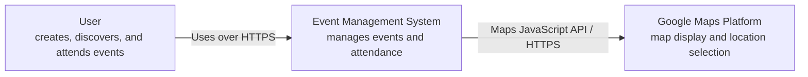
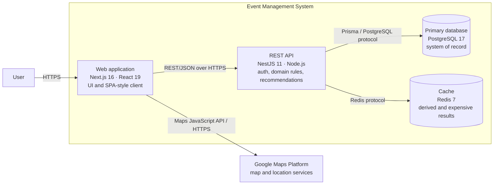
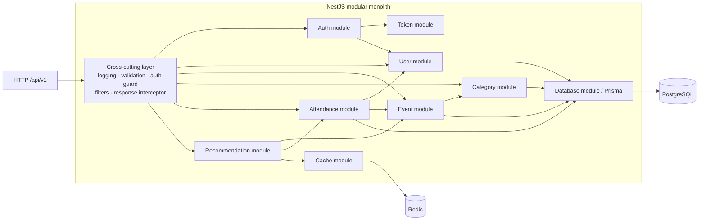
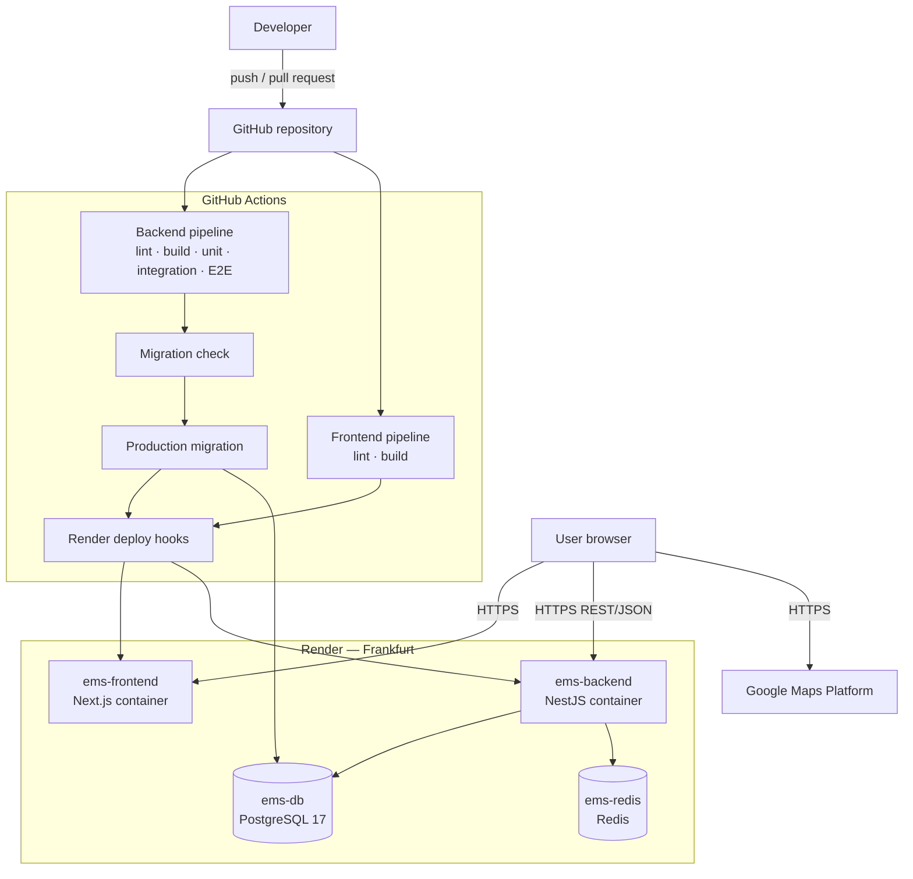

# Architecture — Event Management System

This document describes the architecture implemented in this repository. For detailed UML views, domain models, and
interaction sequences, see [UML.md](UML.md). Identity and token handling are covered in
[IDENTITY_MANAGEMENT.md](IDENTITY_MANAGEMENT.md).

## 1. Architecture classification

| Dimension | Classification | Evidence |
|---|---|---|
| Overall system | Distributed three-tier web application | Browser client, application API, and data/cache tiers are separately deployed |
| Frontend | Next.js application with SPA-style client behavior | App Router, React client providers, TanStack Query, Axios, and browser token storage |
| Backend | Modular monolith with layered modules | One NestJS process contains feature modules organized as controller → service → repository |
| API | Synchronous REST/JSON API | The browser calls the versioned `/api/v1` endpoints over HTTPS |
| Data | Relational persistence with distributed cache | PostgreSQL is the system of record; Redis caches derived/expensive data |
| Deployment | Containerized cloud PaaS | Docker images run as Render web services; PostgreSQL and Redis are managed Render services |
| Scaling model | Stateless application instances plus shared state services | JWT authentication and external PostgreSQL/Redis allow application replicas |

In short:

- **Not microservices:** all backend business capabilities are compiled and deployed as one NestJS application.
- **Not serverless:** the frontend and backend run as long-lived Node.js containers, not functions.
- **Not a static SPA:** Next.js is served by a Node.js runtime and can use framework rendering, although the current
  authenticated application behaves mainly like an SPA after loading.
- **Cloud-hosted:** production infrastructure is declared for Render in `render.yaml`.
- **Cloud-native practices, not fully cloud-native:** the application uses containers, externalized configuration,
  stateless compute, health-aware dependencies, and CI/CD, but has no orchestrator, service mesh, or autoscaling policy.

## 2. System context

The Event Management System owns user, category, event, and attendance data. Google Maps is an external client-side
dependency; it does not own EMS domain data.

## 3. Container view

### Container responsibilities

#### Web application

- Routes and layouts are implemented with the Next.js App Router.
- MUI and Tailwind provide presentation.
- React Hook Form and Zod perform client-side form handling and validation.
- TanStack Query manages server state and client caching.
- Axios calls the backend directly from the browser.
- Authentication state and JWTs are held in browser storage; the client refreshes an expired access token once and
  retries the failed request.
- The browser integrates directly with Google Maps.

The web container must not implement authoritative domain rules. Client validation improves usability, but the API
must validate every request.

#### REST API

- NestJS exposes URI-versioned endpoints under `/api/v1`.
- Controllers handle HTTP concerns.
- Services implement use cases and domain orchestration.
- Repositories isolate Prisma queries.
- Joi schemas and global pipes validate input.
- Guards validate JWT access tokens and attach the authenticated user.
- Filters and interceptors standardize errors and success responses.
- The recommendation module composes category, location, time, and collaborative strategies.

#### PostgreSQL

PostgreSQL is the source of truth for:

- users and password hashes;
- event categories;
- events and their locations;
- attendance relationships.

Prisma owns schema mapping and migrations. Production migrations run before backend deployment.

#### Redis

Redis contains disposable derived data. Cache loss may reduce performance but must not cause loss of business data.
The current primary use is recommendation caching.

## 4. Backend component view

Modules are code boundaries, not independently deployed services. Calls between them are in-process TypeScript method
calls and share one release lifecycle and one database.

## 5. Main runtime flows

### Authenticated API request

1. The browser reads the access token from local storage.
2. The Axios request interceptor adds `Authorization: Bearer <token>`.
3. The NestJS guard validates the JWT and loads the user.
4. The controller delegates to a service; repositories access PostgreSQL through Prisma.
5. The response interceptor returns the standard API envelope.
6. On `401`, the client uses the refresh token to obtain one new access token and retries the original request.

Detailed registration, login, refresh, and logout behavior is in
[IDENTITY_MANAGEMENT.md](IDENTITY_MANAGEMENT.md).

### Recommendation request

1. The browser requests recommendations for an event.
2. The API checks Redis using an event/user-specific key.
3. On a cache miss, the recommendation service loads event and attendance data.
4. Strategy components score candidate events by category, location, time, and collaborative similarity.
5. The API stores the derived result in Redis with a TTL and returns it.

## 6. Deployment view

### Local deployment

`docker-compose.yaml` provides equivalent local containers:

1. PostgreSQL and Redis start and pass health checks.
2. A one-shot migrator applies Prisma migrations.
3. The NestJS backend starts on host port `4000`.
4. The Next.js frontend starts on host port `3000`.

All local containers share the `app-network` bridge. Named volumes persist PostgreSQL and Redis data.

### Production deployment

`render.yaml` declares:

- one Docker-based frontend web service;
- one Docker-based backend web service;
- one managed PostgreSQL 17 database;
- one managed Redis-compatible key-value service;
- production configuration through environment variables and generated secrets.

GitHub Actions validates both applications. The backend workflow validates and applies database migrations before
triggering its Render deployment.

## 7. Data ownership and consistency

- The backend is the only component that accesses PostgreSQL and Redis.
- Feature modules logically own their domain records, but all modules share one physical schema.
- PostgreSQL transactions and foreign keys provide consistency inside the monolith.
- Redis is never authoritative.
- External Google Maps responses are used to select display text and coordinates; stored event data remains owned by
  EMS.

## 8. Quality attributes and trade-offs

### Maintainability

Feature modules and controller/service/repository layers provide clear internal boundaries without distributed-system
overhead. The trade-off is that module boundaries are enforced by convention and NestJS dependencies, not by network
isolation.

### Scalability

Frontend and backend containers can be replicated because durable state is external. PostgreSQL capacity and connection
limits are the principal scaling constraint. Redis reduces repeated recommendation work.

### Availability

The application depends on PostgreSQL for core operations. Redis should degrade performance rather than correctness,
provided cache failures are handled as misses. Render service/database availability defines the current production
availability ceiling.

### Security

The API validates input, hashes passwords with bcrypt, and protects endpoints with JWT guards. Current tokens are stored
in browser local storage, so prevention of cross-site scripting is especially important. Secrets belong in environment
variables and CI secret stores, never in the repository.

### Operability

Docker gives local/production runtime parity, Swagger exposes API documentation, and CI runs lint, builds, tests, and
migration checks. The application currently has request logging but no declared centralized metrics, tracing, alerting,
backup policy, or disaster-recovery objective.

## 9. Evolution guidelines

Keep the modular monolith while its release cadence, scaling profile, and team ownership remain shared. Consider
extracting a module into a service only when there is measured need for at least one of:

- independent scaling;
- independent deployment or availability;
- a distinct data-ownership boundary;
- isolation of long-running or failure-prone work;
- separate team ownership.

Likely future boundaries include asynchronous notifications or compute-heavy recommendation processing. Extraction
would require an explicit API/event contract, independent persistence ownership, observability, retries, and failure
handling; splitting code into another process alone would not create a sound microservice.

## 10. Documentation maintenance

Update this document when a runtime container, external dependency, deployment target, or major communication path
changes. Update [UML.md](UML.md) when domain relationships, module internals, or interaction sequences change. Mermaid
blocks are the canonical Diagram-as-Code sources and render directly in GitHub-compatible Markdown.
