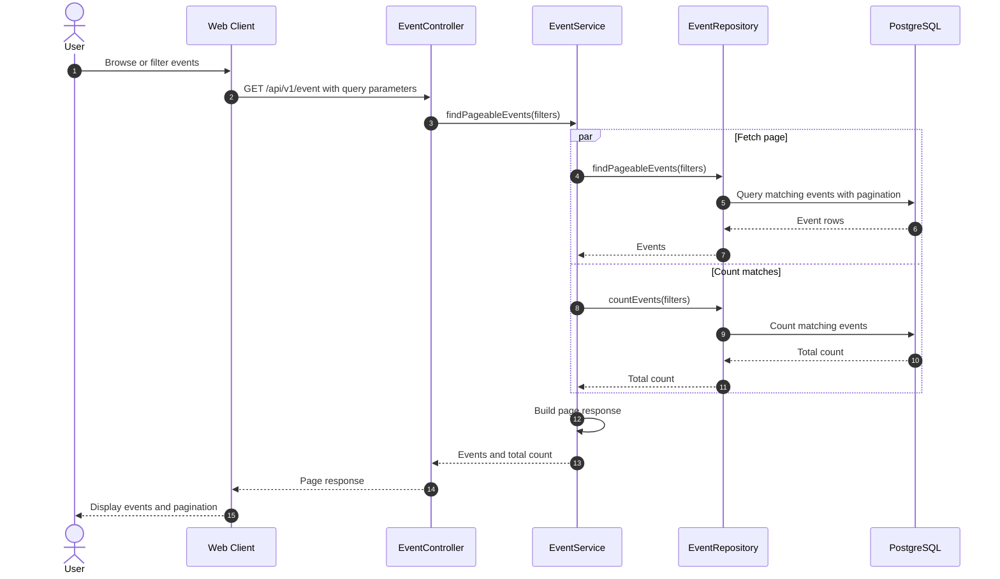
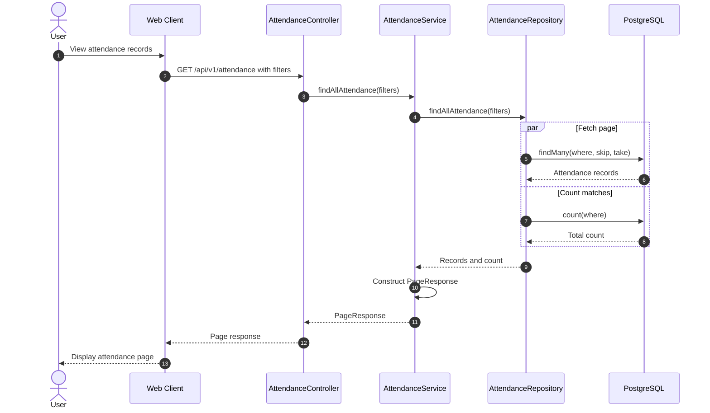
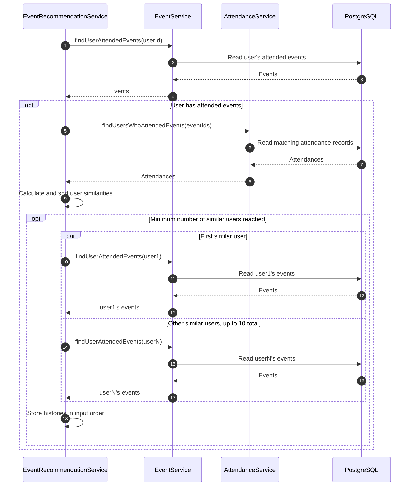
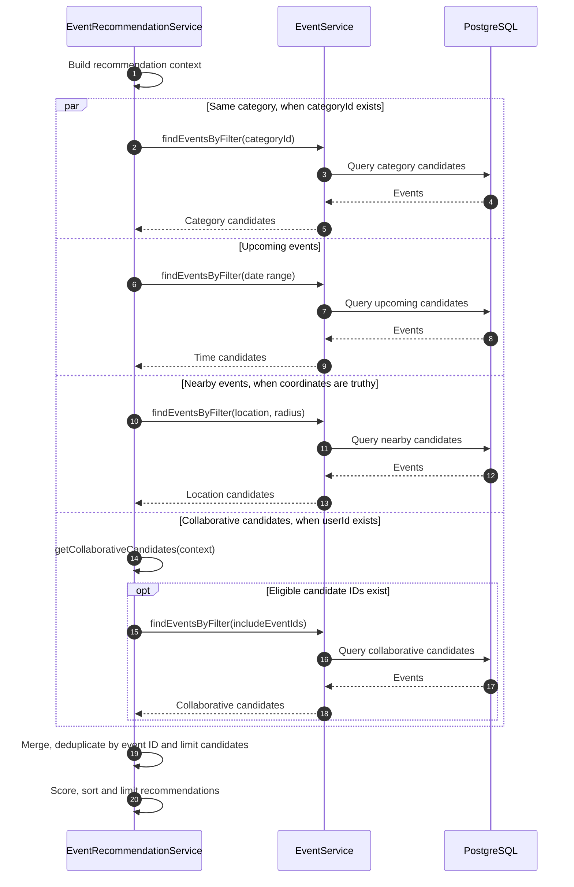
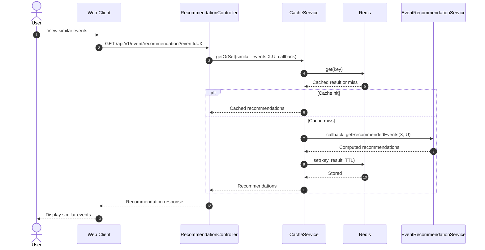
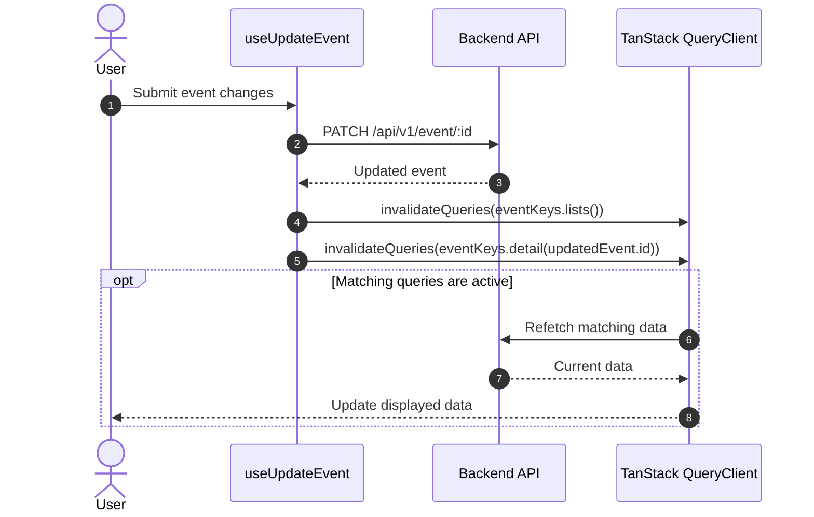

# Concurrency and Distributed Patterns — Event Management System (EMS)

Companion to [SRS.md](SRS.md) and [UML.md](UML.md). This document describes six implemented flows and links them to the SRS requirements. The sequence diagrams use Mermaid and render on GitHub. Authentication and validation are omitted from individual diagrams where they do not affect the pattern.

`par` shows asynchronous operations whose execution can overlap; it does not guarantee simultaneous CPU execution or database processing. The backend uses `Promise.all` to join concurrent operations. The caching examples describe coordination between the client, API, Redis and PostgreSQL; they do not imply transactions or distributed locks.

| Flow | Use case and requirements | Pattern | Implementation |
|---|---|---|---|
| 1 | Browse and filter events (FR-EVT-2/3) | Fan-out / fan-in | [`EventService`](../backend/src/modules/event/event.service.ts) |
| 2 | View attendances (FR-ATT-2) | Fan-out / fan-in | [`AttendanceRepository`](../backend/src/modules/attendance/attendance.repository.ts) |
| 3 | Build personalized recommendations (FR-REC-1) | Bounded fan-out / fan-in | [`EventRecommendationService`](../backend/src/modules/event/recommendation/event-recommendation.service.ts) |
| 4 | Collect recommendation candidates (FR-REC-1) | Scatter / gather | [`EventRecommendationService`](../backend/src/modules/event/recommendation/event-recommendation.service.ts) |
| 5 | Retrieve cached recommendations (FR-REC-1/2) | Cache-aside | [`EventRecommendationController`](../backend/src/modules/event/recommendation/event-recommendation.controller.ts), [`CacheService`](../backend/src/modules/cache/cache.service.ts) |
| 6 | Edit an event (FR-EVT-5) | Client cache invalidation | [`useUpdateEvent`](../frontend/src/hooks/api/useEvents.ts) |

---

## 1. Browse events — fan-out / fan-in (FR-EVT-2, FR-EVT-3)

**Scenario.** An authenticated user requests a page of events, optionally with search, filters and sorting. The response needs both the page contents and the total matching count.

**How it works.** `findPageableEvents` starts both repository calls in `Promise.all` (fan-out), then combines the results into a page response after both finish (fan-in). The operations can overlap, reducing the time spent waiting for independent I/O.

**Limits.** If either operation fails, `Promise.all` rejects; it does not cancel the other operation. The two reads are not in a shared transaction, so concurrent writes may cause the page and count to reflect different database states. Source: [`event.service.ts`](../backend/src/modules/event/event.service.ts), [`event.repository.ts`](../backend/src/modules/event/event.repository.ts).

---

## 2. View attendances — parallel pagination queries (FR-ATT-2)

**Scenario.** An authenticated user requests a paginated list of attendance records, optionally filtered by event.

**How it works.** The repository fans out the Prisma `findMany` and `count` calls with `Promise.all`, and joins their results before the service constructs `PageResponse`. This applies the same concurrency pattern to a different use case and at the repository layer.

**Limits.** A failure of either query rejects the combined operation. There is no shared transaction for these reads, so concurrent attendance changes can make the count and page disagree. Source: [`attendance.repository.ts`](../backend/src/modules/attendance/attendance.repository.ts), [`attendance.service.ts`](../backend/src/modules/attendance/attendance.service.ts).

---

## 3. Load similar users' histories — bounded fan-out / fan-in (FR-REC-1)

**Scenario.** To personalize recommendations, the system finds users with overlapping attendance histories. If enough similar users are found, it loads the events attended by up to ten of them.

**How it works.** The initial reads are sequential because similarity calculation depends on them. Once the similar users are known, `Promise.all` launches independent history lookups together and collects their results. The list is capped at ten users, bounding the number of lookups in this fan-out; `Promise.all` preserves input order, which the scoring code uses to associate each history with its user.

**Limits.** One rejected lookup fails the entire group; the code has no partial-result fallback or retry here. The reads are not a single consistent snapshot. Source: [`event-recommendation.service.ts`](../backend/src/modules/event/recommendation/event-recommendation.service.ts).

---

## 4. Generate recommendation candidates — scatter / gather (FR-REC-1)

**Scenario.** After building the recommendation context, the service gathers events from several criteria before scoring them.

**How it works.** `generateCandidates` scatters independent searches through a `Promise.all`, then gathers and deduplicates their results before scoring. A missing category, falsy coordinate, or missing user ID causes the corresponding branch to resolve to an empty array; the collaborative branch can also return empty when its prerequisites are not met.

**Limits.** Any rejected branch fails the whole gather. The result is not guaranteed to reflect one database snapshot. The coordinate check uses truthiness, so a latitude or longitude of zero skips the nearby branch. Source: [`event-recommendation.service.ts`](../backend/src/modules/event/recommendation/event-recommendation.service.ts).

---

## 5. Retrieve recommendations — cache-aside (FR-REC-1, FR-REC-2)

**Scenario.** An authenticated user requests similar events. The API looks up a result keyed by event and user and computes it only on a cache miss.

**How it works.** This is cache-aside: application code checks the cache, calls the recommendation service on a miss and writes the computed value back. The key includes both event and user IDs. `getOrSet` passes the configured default constant `300000` when no TTL is supplied; the cache module configures a Redis store. This reduces repeated computation and database reads while the entry remains available.

**Limits.** There is no single-flight or lock: concurrent misses for the same key can compute and write the same result independently. No invalidation of these recommendation keys is implemented in the event or attendance mutation paths, so cached recommendations can be stale until expiration or eviction. Source: [`event-recommendation.controller.ts`](../backend/src/modules/event/recommendation/event-recommendation.controller.ts), [`cache.service.ts`](../backend/src/modules/cache/cache.service.ts), [`cache.module.ts`](../backend/src/modules/cache/cache.module.ts), [`cache.constants.ts`](../backend/src/modules/cache/cache.constants.ts).

---

## 6. Edit an event — client cache invalidation (FR-EVT-5)

**Scenario.** After an event update succeeds, the client marks its cached event lists and the updated event's detail as stale.

**How it works.** The successful mutation triggers invalidation by query key. Matching cached queries become stale, and active ones are normally refetched by TanStack Query. This coordinates a server write with the current client's cached reads without having to manually update every list.

**Limits.** The server write and subsequent refetch are not atomic, so the client can temporarily show older data. The hook does not invalidate `eventKeys.similar` or the server's Redis recommendation cache, and it does not notify other clients. Source: [`useEvents.ts`](../frontend/src/hooks/api/useEvents.ts), [`eventService.ts`](../frontend/src/lib/api/eventService.ts).
