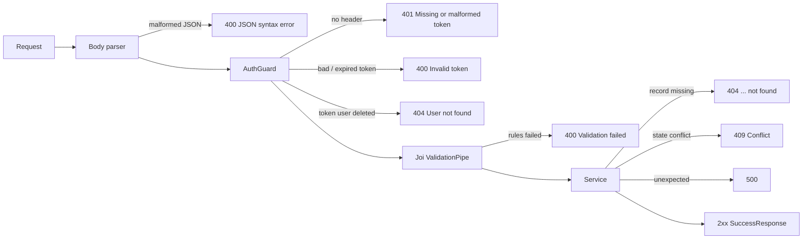
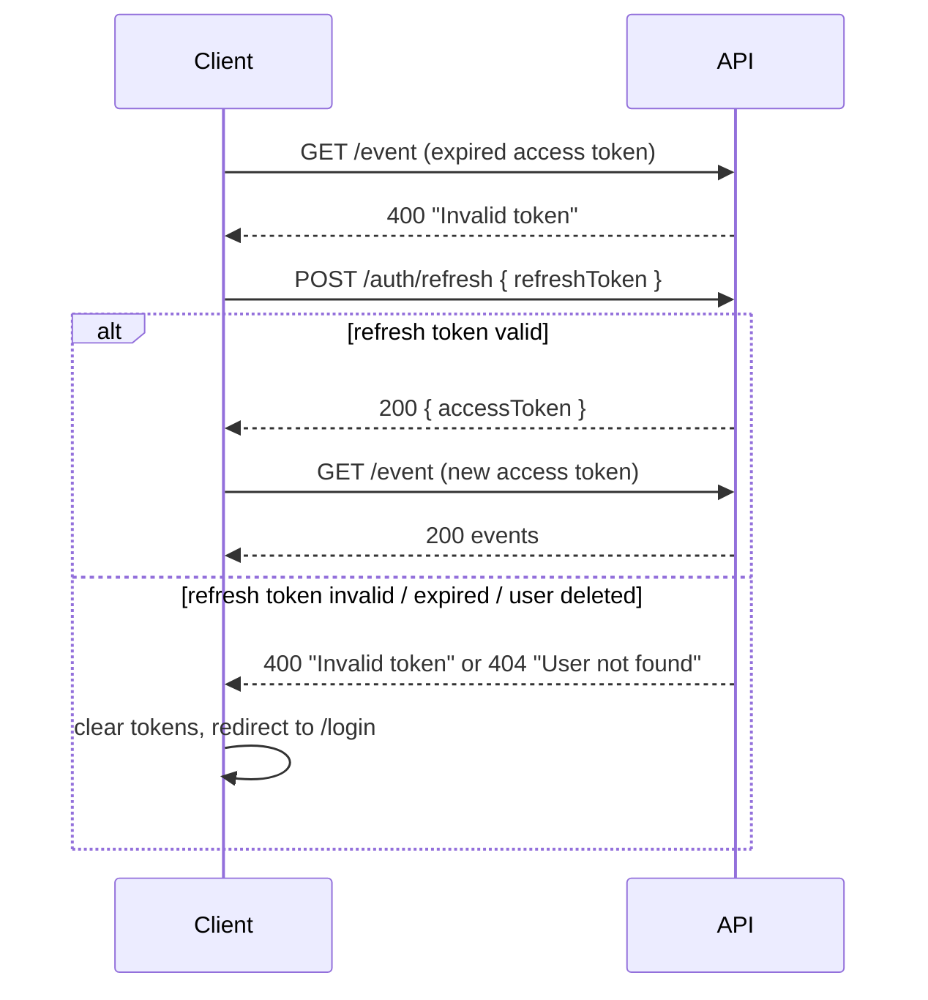

# Error Handling

## Event Management System (EMS) API

|                 |                                                                                  |
|-----------------|----------------------------------------------------------------------------------|
| **Version**     | 1.0                                                                              |
| **Prepared by** | FourCast                                                                         |
| **Date**        | 2026-10-27                                                                       |
| **Status**      | Describes the system as implemented on branch `main`; planned codes are marked   |
| **Base URL**    | `https://ems-backend-8b3e.onrender.com/api/v1`                                   |
| **Swagger UI**  | [https://ems-backend-8b3e.onrender.com/api/docs#/](https://ems-backend-8b3e.onrender.com/api/docs#/) |
| **OpenAPI**     | `backend/generated/openapi/swagger.json` (generated, see [section 7.1](#71-generating-swaggerjson)) |

Related documents in this folder:

- [SRS.md](SRS.md) — software requirements specification
- [UML.md](UML.md) — UML models
- [IDENTITY_MANAGEMENT.md](IDENTITY_MANAGEMENT.md) — authentication, tokens and authorization

Response bodies in this document were captured from the deployed API on 2026-10-27, or, where a
request would change production data (e.g. `DELETE /category/{id}` → 409), taken from the code
path that produces them. Responses marked **Planned** describe the contract the API will follow
once that status code is implemented; today the API does not return them.

---

## Table of Contents

1. [Error Response Format](#1-error-response-format)
2. [How an Error Is Produced](#2-how-an-error-is-produced)
3. [Status Code Catalog](#3-status-code-catalog)
4. [Error Message Catalog](#4-error-message-catalog)
5. [Endpoint Examples](#5-endpoint-examples)
6. [Client Handling Guide](#6-client-handling-guide)
7. [OpenAPI / Swagger Documentation](#7-openapi--swagger-documentation)
8. [Known Gaps](#8-known-gaps)

---

## 1. Error Response Format

All responses, successful or not, use the same envelope (`GlobalResponse`). An error is a
response with `isError: true`.

```json
{
  "statusCode": 404,
  "message": "Event not found",
  "name": "NOT_FOUND",
  "data": {},
  "isError": true
}
```

| Field        | Type      | Description                                                                                        |
|--------------|-----------|----------------------------------------------------------------------------------------------------|
| `statusCode` | `integer` | HTTP status code, always equal to the status line of the response.                                 |
| `message`    | `string`  | Human-readable summary. Stable for a given error, so clients may match on it (see section 4).      |
| `name`       | `string`  | Name of the status in `HttpStatus`: `BAD_REQUEST`, `UNAUTHORIZED`, `NOT_FOUND`, `CONFLICT`, ...    |
| `data`       | `object`  | Error details. `{}` when there are none; `{ "data": [ ... ] }` for validation errors.              |
| `isError`    | `boolean` | Always `true` for errors, `false` for successful responses.                                        |

### 1.1 Validation error details

When request validation fails (status 400, `message: "Validation failed"`), `data.data` lists
**every** failed rule, not only the first one (Joi runs with `abortEarly: false`):

```json
{
  "statusCode": 400,
  "message": "Validation failed",
  "name": "BAD_REQUEST",
  "data": {
    "data": [
      { "path": "email", "message": "Email must be a valid email address" },
      { "path": "password", "message": "Password must be at least 6 characters long" }
    ]
  },
  "isError": true
}
```

| Field     | Type     | Description                                                                                                          |
|-----------|----------|----------------------------------------------------------------------------------------------------------------------|
| `path`    | `string` | Dotted path of the invalid field in the body or query. `""` when the rule applies to the whole value (path parameter, empty body). |
| `message` | `string` | What is wrong with that field, ready to show next to a form input.                                                   |

### 1.2 OpenAPI schema

```yaml
components:
  schemas:
    ErrorResponse:
      type: object
      required: [statusCode, message, name, data, isError]
      properties:
        statusCode:
          type: integer
          example: 400
        message:
          type: string
          example: Validation failed
        name:
          type: string
          example: BAD_REQUEST
        data:
          type: object
          description: Error details; empty object when there are none
          properties:
            data:
              type: array
              description: Present only for validation errors
              items:
                $ref: '#/components/schemas/ValidationErrorItem'
        isError:
          type: boolean
          enum: [true]
    ValidationErrorItem:
      type: object
      required: [path, message]
      properties:
        path:
          type: string
          example: email
        message:
          type: string
          example: Email must be a valid email address
```

---

## 2. How an Error Is Produced

A request passes these stages in order. The first stage that fails decides the response, so a
request with several problems gets the error of the earliest stage only.



| Stage                | Source                                                  | Errors                       |
|----------------------|---------------------------------------------------------|------------------------------|
| Body parser          | Express JSON parser                                     | 400 with the parser message  |
| `AuthGuard`          | `src/guards/user.guard.ts`, `TokenService`              | 401, 400, 404                |
| `ValidationPipe`     | `src/pipes/validation.pipe.ts` + module `schemas/*.ts`  | 400 `Validation failed`      |
| Services             | `checkExists()`, `ConflictException`                    | 404, 409                     |
| Exception filters    | `src/filters/*.ts`                                      | wrap all of the above, 500   |

Exception filters turn every exception into the envelope from section 1:

| Filter            | Catches                     | Result                                                     |
|-------------------|-----------------------------|------------------------------------------------------------|
| `ExceptionFilter` | `HttpException`             | Its status and message; extra fields go to `data`.         |
| `ErrorFilter`     | any other `Error`           | 500 with the error's own message.                          |
| `GlobalFilter`    | anything else (non-`Error`) | 500 `Unexpected error`.                                    |

Because the guard runs before the pipes, `GET /event/not-a-uuid` **without** a token returns 401,
not 400.

---

## 3. Status Code Catalog

| Code    | Name                    | Status          | When the API returns it                                                                 | Retry?                                  |
|---------|-------------------------|-----------------|-----------------------------------------------------------------------------------------|-----------------------------------------|
| **400** | `BAD_REQUEST`           | Implemented     | Malformed JSON; validation failed; invalid credentials; invalid or expired token.       | No — fix the request (or refresh token). |
| **401** | `UNAUTHORIZED`          | Implemented     | `Authorization` header missing; token payload has no user.                               | After login.                            |
| **403** | `FORBIDDEN`             | **Planned**     | Authenticated user changes or deletes an event or category they do not own.             | No.                                     |
| **404** | `NOT_FOUND`             | Implemented     | Record with the given ID does not exist; token user was deleted; unknown route.         | No.                                     |
| **409** | `CONFLICT`              | Implemented     | Email already registered; category still used by events.                                | No — change data or resolve conflict.   |
| **422** | `UNPROCESSABLE_ENTITY`  | **Planned**     | Request is valid in shape but breaks a business rule (e.g. register for a past event).  | No.                                     |
| **429** | `TOO_MANY_REQUESTS`     | **Planned**     | Client exceeded the rate limit (e.g. login brute force).                                | Yes, after `Retry-After` seconds.       |
| **500** | `INTERNAL_SERVER_ERROR` | Implemented     | Unexpected server or database error.                                                    | Yes, with backoff, max 3 times.         |

### 3.1 400 vs 422

The API uses **400** for anything a schema can check on its own: missing fields, wrong types,
formats, lengths, ranges and cross-field rules such as `endDate >= startDate`.
**422** is reserved for rules that need the database state, e.g. "the event has already ended".
Today no endpoint has such a rule, so 422 is never returned (see [section 8](#8-known-gaps)).

### 3.2 Planned response contracts

**403 Forbidden** — the user is authenticated but is not the owner (`createdById`) of the resource.

```json
{
  "statusCode": 403,
  "message": "Only the event creator can modify this event",
  "name": "FORBIDDEN",
  "data": {},
  "isError": true
}
```

**422 Unprocessable Entity** — business rule failed. `data.rule` names the rule so clients can
branch without parsing `message`.

```json
{
  "statusCode": 422,
  "message": "Cannot register for an event that has already ended",
  "name": "UNPROCESSABLE_ENTITY",
  "data": { "rule": "EVENT_ENDED", "endDate": "2026-10-01T18:00:00.000Z" },
  "isError": true
}
```

**429 Too Many Requests** — sent with a `Retry-After` header (seconds). Planned limits: 5
requests / minute per IP for `/auth/login`, `/auth/register` and `/auth/refresh`; 100 requests /
minute per user for all other endpoints.

```http
HTTP/1.1 429 Too Many Requests
Retry-After: 42
Content-Type: application/json
```

```json
{
  "statusCode": 429,
  "message": "Too many requests, try again later",
  "name": "TOO_MANY_REQUESTS",
  "data": { "retryAfter": 42, "limit": 5, "window": 60 },
  "isError": true
}
```

---

## 4. Error Message Catalog

`message` values the API returns today. Clients may match on them exactly.

| Status | `message`                            | Raised by                           | Meaning                                                      |
|--------|--------------------------------------|-------------------------------------|--------------------------------------------------------------|
| 400    | `Validation failed`                  | `ValidationPipe`                    | See `data.data` for the failed fields.                       |
| 400    | `Invalid credentials`                | `AuthService.login`                 | Email not registered or password wrong (deliberately not told apart). |
| 400    | `Invalid token`                      | `TokenService`                      | Token malformed, signature wrong, **expired**, or wrong type (refresh token used as access token or vice versa). |
| 400    | `Unexpected token ...` / `Expected property name ...` | Express JSON parser | Body is not valid JSON.                                      |
| 401    | `Missing or malformed token`         | `AuthGuard`                         | No `Authorization` header.                                   |
| 401    | `Invalid payload`                    | `AuthService`                       | Token is signed but has no `userId`.                         |
| 404    | `User not found`                     | `UserService`                       | User of the token or of `userId` does not exist.             |
| 404    | `Event not found`                    | `EventService`                      | No event with that ID.                                       |
| 404    | `Category not Found`                 | `CategoryService`                   | No category with that ID.                                    |
| 404    | `Attendance not found`               | `AttendanceService`                 | No attendance with that ID.                                  |
| 404    | `Cannot <METHOD> <path>`             | NestJS router                       | Route does not exist.                                        |
| 409    | `User already exist`                 | `UserService`                       | Email is taken by another user.                              |
| 409    | `Category is used by events`         | `CategoryService.deleteCategory`    | Category has events and cannot be deleted.                   |
| 500    | `Unexpected error` or internal text  | `GlobalFilter` / `ErrorFilter`      | Server failure.                                              |

---

## 5. Endpoint Examples

Ten endpoints with requests, the exact error responses and what the client must do. `$TOKEN` is a
valid access token from `/auth/login`; `$BASE` is `https://ems-backend-8b3e.onrender.com/api/v1`.

| #  | Endpoint                         | Errors shown                         |
|----|----------------------------------|--------------------------------------|
| 1  | `POST /auth/register`            | 400 validation, 409, 429*            |
| 2  | `POST /auth/login`               | 400 malformed JSON, 400 credentials, 429* |
| 3  | `POST /auth/refresh`             | 400 invalid token, 404               |
| 4  | `GET /event`                     | 401, 400 invalid token, 400 query    |
| 5  | `POST /event`                    | 400 validation, 404 category         |
| 6  | `GET /event/{id}`                | 400 UUID, 404                        |
| 7  | `PATCH /event/{id}`              | 404, 403*                            |
| 8  | `DELETE /category/{id}`          | 404, 409, 403*                       |
| 9  | `POST /attendance`               | 404, 409*, 422*                      |
| 10 | `PATCH /user/me`                 | 400 empty body, 409, 404             |

\* Planned.

### 5.1 `POST /auth/register` — register a user

**400 — validation failed** (several fields at once)

```http
POST /api/v1/auth/register
Content-Type: application/json

{ "email": "bad", "firstName": "", "password": "123" }
```

```json
{
  "statusCode": 400,
  "message": "Validation failed",
  "name": "BAD_REQUEST",
  "data": {
    "data": [
      { "path": "email", "message": "Email must be a valid email address" },
      { "path": "firstName", "message": "\"firstName\" is not allowed to be empty" },
      { "path": "lastName", "message": "Last name is required" },
      { "path": "password", "message": "Password must be at least 6 characters long" }
    ]
  },
  "isError": true
}
```

*Client:* show each `message` under the input named by `path`; keep what the user typed; do not
send again until the form passes the same rules locally.

**409 — email already registered**

```http
POST /api/v1/auth/register
Content-Type: application/json

{ "email": "user1@example.com", "firstName": "Test", "lastName": "User", "password": "password123" }
```

```json
{
  "statusCode": 409,
  "message": "User already exist",
  "name": "CONFLICT",
  "data": {},
  "isError": true
}
```

*Client:* mark the email field ("This email is already registered") and offer a link to the login
page with the email prefilled. Do not retry.

**429 — Planned:** more than 5 registrations per minute from one IP.
*Client:* disable the submit button and show a countdown for `Retry-After` seconds.

### 5.2 `POST /auth/login` — log in

**400 — malformed JSON**

```http
POST /api/v1/auth/login
Content-Type: application/json

{"email":"a"
```

```json
{
  "statusCode": 400,
  "message": "Expected property name or '}' in JSON at position 1 (line 1 column 2)",
  "name": "BAD_REQUEST",
  "data": {},
  "isError": true
}
```

*Client:* this is a client bug, not a user error. Log it with the request body and show a generic
"Something went wrong" message. Always build bodies with `JSON.stringify`.

**400 — invalid credentials**

```http
POST /api/v1/auth/login
Content-Type: application/json

{ "email": "nobody@example.com", "password": "wrongpass" }
```

```json
{
  "statusCode": 400,
  "message": "Invalid credentials",
  "name": "BAD_REQUEST",
  "data": {},
  "isError": true
}
```

*Client:* show "Wrong email or password" above the form (not under one field — the API does not
say which one is wrong, on purpose). Clear the password field, keep the email.

**429 — Planned:** more than 5 login attempts per minute from one IP.

```json
{
  "statusCode": 429,
  "message": "Too many requests, try again later",
  "name": "TOO_MANY_REQUESTS",
  "data": { "retryAfter": 42, "limit": 5, "window": 60 },
  "isError": true
}
```

*Client:* block the form and show "Too many attempts, try again in 42 s". Do not retry
automatically.

### 5.3 `POST /auth/refresh` — get a new access token

**400 — invalid token** (here: an access token sent instead of a refresh token; an expired or
tampered refresh token returns the same response)

```http
POST /api/v1/auth/refresh
Content-Type: application/json

{ "refreshToken": "eyJhbGciOiJIUzI1NiIs...<access token>" }
```

```json
{
  "statusCode": 400,
  "message": "Invalid token",
  "name": "BAD_REQUEST",
  "data": {},
  "isError": true
}
```

*Client:* the session cannot be renewed. Delete both stored tokens and redirect to login, keeping
the current URL to return to after login. Never call `/auth/refresh` again with the same token.

**404 — user of the token was deleted**

```json
{
  "statusCode": 404,
  "message": "User not found",
  "name": "NOT_FOUND",
  "data": {},
  "isError": true
}
```

*Client:* same as above — clear tokens and go to login.

### 5.4 `GET /event` — list events

**401 — no token**

```http
GET /api/v1/event
```

```json
{
  "statusCode": 401,
  "message": "Missing or malformed token",
  "name": "UNAUTHORIZED",
  "data": {},
  "isError": true
}
```

*Client:* go to login. If the client believed it had a token, this is a bug in the request layer
(header not attached).

**400 — invalid or expired access token**

```http
GET /api/v1/event
Authorization: Bearer abc.def.ghi
```

```json
{
  "statusCode": 400,
  "message": "Invalid token",
  "name": "BAD_REQUEST",
  "data": {},
  "isError": true
}
```

*Client:* the access token has most likely expired. Call `/auth/refresh` **once**, store the new
access token and repeat the original request. If refresh fails, go to login (see
[section 6.2](#62-token-refresh)).

**400 — invalid query parameters**

```http
GET /api/v1/event?pageSize=1000&sortBy=price&startDate=2026-12-01&endDate=2026-11-01
Authorization: Bearer $TOKEN
```

```json
{
  "statusCode": 400,
  "message": "Validation failed",
  "name": "BAD_REQUEST",
  "data": {
    "data": [
      { "path": "pageSize", "message": "Page size cannot exceed 500" },
      { "path": "endDate", "message": "End date must be greater than or equal to start date" },
      { "path": "sortBy", "message": "Sort by must be either \"date\", \"title\", or \"createdAt\"" }
    ]
  },
  "isError": true
}
```

*Client:* query parameters usually come from filters in the UI or from the URL. Show the messages
next to the filter controls; if they came from a shared link, reset the invalid parameters to
their defaults and load again.

### 5.5 `POST /event` — create an event

**400 — validation failed** (cross-field and range rules)

```http
POST /api/v1/event
Authorization: Bearer $TOKEN
Content-Type: application/json

{
  "title": "Tech Meetup",
  "description": "Monthly meetup",
  "startDate": "2026-12-10T10:00:00Z",
  "endDate": "2026-12-09T10:00:00Z",
  "location": "Lviv",
  "latitude": 120
}
```

```json
{
  "statusCode": 400,
  "message": "Validation failed",
  "name": "BAD_REQUEST",
  "data": {
    "data": [
      { "path": "endDate", "message": "End date must be greater than or equal to start date" },
      { "path": "latitude", "message": "Latitude must be between -90 and 90" }
    ]
  },
  "isError": true
}
```

*Client:* show each message under its field. Validate the same rules in the form (dates order,
coordinate ranges) so the user rarely reaches this error.

**404 — category not found**

```http
POST /api/v1/event
Authorization: Bearer $TOKEN
Content-Type: application/json

{ "title": "Tech Meetup", "description": "Monthly meetup", "startDate": "2026-12-10T10:00:00Z",
  "endDate": "2026-12-10T12:00:00Z", "location": "Lviv",
  "categoryId": "00000000-0000-4000-8000-000000000000" }
```

```json
{
  "statusCode": 404,
  "message": "Category not Found",
  "name": "NOT_FOUND",
  "data": {},
  "isError": true
}
```

*Client:* the category list in the form is stale (someone deleted the category). Reload the
categories, clear the selected one and ask the user to choose again.

### 5.6 `GET /event/{id}` — get one event

**400 — ID is not a UUID**

```http
GET /api/v1/event/not-a-uuid
Authorization: Bearer $TOKEN
```

```json
{
  "statusCode": 400,
  "message": "Validation failed",
  "name": "BAD_REQUEST",
  "data": { "data": [ { "path": "", "message": "Value must be a valid UUID" } ] },
  "isError": true
}
```

*Client:* the URL is broken (typed by hand or truncated). Show the "Event not found" page — for
the user it is the same as 404.

**404 — event does not exist**

```http
GET /api/v1/event/00000000-0000-4000-8000-000000000000
Authorization: Bearer $TOKEN
```

```json
{
  "statusCode": 404,
  "message": "Event not found",
  "name": "NOT_FOUND",
  "data": {},
  "isError": true
}
```

*Client:* show a "This event no longer exists" page with a link to the event list, and remove
the event from any cached lists.

### 5.7 `PATCH /event/{id}` — update an event

**404 — event does not exist**

```http
PATCH /api/v1/event/00000000-0000-4000-8000-000000000000
Authorization: Bearer $TOKEN
Content-Type: application/json

{ "title": "New title" }
```

```json
{
  "statusCode": 404,
  "message": "Event not found",
  "name": "NOT_FOUND",
  "data": {},
  "isError": true
}
```

*Client:* the event was deleted while the user was editing it. Tell the user, discard the edit
form and return to the list.

**403 — Planned:** the current user is not the event's creator.

```json
{
  "statusCode": 403,
  "message": "Only the event creator can modify this event",
  "name": "FORBIDDEN",
  "data": {},
  "isError": true
}
```

*Client:* do not retry and do not log out — the session is fine. Show "You can only edit your own
events" and hide the Edit / Delete buttons for events where `createdById` is not the current
user, so this error stays rare.

### 5.8 `DELETE /category/{id}` — delete a category

**404 — category does not exist**

```http
DELETE /api/v1/category/00000000-0000-4000-8000-000000000000
Authorization: Bearer $TOKEN
```

```json
{
  "statusCode": 404,
  "message": "Category not Found",
  "name": "NOT_FOUND",
  "data": {},
  "isError": true
}
```

*Client:* the category is already gone; treat it as success — remove it from the list.

**409 — category is used by events**

```http
DELETE /api/v1/category/fd69c863-aaca-4c00-9d91-c041641b15cc
Authorization: Bearer $TOKEN
```

```json
{
  "statusCode": 409,
  "message": "Category is used by events",
  "name": "CONFLICT",
  "data": {},
  "isError": true
}
```

*Client:* explain that the category must be removed from all events first and link to
`GET /event?categoryId=<id>` so the user can see them. Do not retry.

**403 — Planned:** the current user did not create the category. Handle as in 5.7.

### 5.9 `POST /attendance` — register for an event

**404 — event does not exist**

```http
POST /api/v1/attendance
Authorization: Bearer $TOKEN
Content-Type: application/json

{ "userId": "0c36eb93-2ade-4873-ba28-d8c53b7350b3", "eventId": "00000000-0000-4000-8000-000000000000" }
```

```json
{
  "statusCode": 404,
  "message": "Event not found",
  "name": "NOT_FOUND",
  "data": {},
  "isError": true
}
```

*Client:* the event was deleted; show a message and refresh the event list. A
`"User not found"` 404 here means a wrong `userId` — a client bug.

**409 — Planned:** the user is already registered for this event.

```json
{
  "statusCode": 409,
  "message": "User is already registered for this event",
  "name": "CONFLICT",
  "data": { "attendanceId": "6f1c9a4e-2b3d-4c5e-8f9a-0b1c2d3e4f5a" },
  "isError": true
}
```

*Client:* treat as success — switch the button to "Registered". Use `data.attendanceId` if the
user wants to cancel.

**422 — Planned:** the event has already ended.

```json
{
  "statusCode": 422,
  "message": "Cannot register for an event that has already ended",
  "name": "UNPROCESSABLE_ENTITY",
  "data": { "rule": "EVENT_ENDED", "endDate": "2026-10-01T18:00:00.000Z" },
  "isError": true
}
```

*Client:* show the message, disable the Register button for that event and refresh its data. Do
not retry.

### 5.10 `PATCH /user/me` — update the current user

**400 — no fields given**

```http
PATCH /api/v1/user/me
Authorization: Bearer $TOKEN
Content-Type: application/json

{}
```

```json
{
  "statusCode": 400,
  "message": "Validation failed",
  "name": "BAD_REQUEST",
  "data": { "data": [ { "path": "", "message": "At least one field must be provided for update" } ] },
  "isError": true
}
```

*Client:* `path` is empty, so show the message at form level. Better: keep the Save button
disabled until something changes.

**409 — email taken by another user**

```http
PATCH /api/v1/user/me
Authorization: Bearer $TOKEN
Content-Type: application/json

{ "email": "user2@example.com" }
```

```json
{
  "statusCode": 409,
  "message": "User already exist",
  "name": "CONFLICT",
  "data": {},
  "isError": true
}
```

*Client:* mark the email field ("This email is already used by another account") and keep the
other changes in the form.

**404 — account was deleted** (token still valid, user gone)

```http
GET /api/v1/user/me
Authorization: Bearer $TOKEN
```

```json
{
  "statusCode": 404,
  "message": "User not found",
  "name": "NOT_FOUND",
  "data": {},
  "isError": true
}
```

*Client:* the account no longer exists. Clear tokens and go to login. This applies to any
protected endpoint, because `AuthGuard` loads the user on every request.

---

## 6. Client Handling Guide

### 6.1 Decision table

| Response                                   | Client action                                                        |
|--------------------------------------------|----------------------------------------------------------------------|
| 400 `Validation failed`                    | Map `data.data[].path` to form fields; `path: ""` → form-level error. |
| 400 `Invalid token`                        | Refresh once and repeat the request; on failure → login.             |
| 400 `Invalid credentials`                  | "Wrong email or password"; clear password.                           |
| 400 other                                  | Client bug (bad JSON). Log, show generic error.                       |
| 401                                        | Clear tokens → login, remember the return URL.                       |
| 403 *(planned)*                            | "You don't have permission"; keep the session; hide the action.      |
| 404 on a page resource                     | "Not found" page; drop it from caches.                               |
| 404 `User not found` on a protected call   | Clear tokens → login.                                                |
| 409                                        | Show the conflict near the related field or action; no retry.        |
| 422 *(planned)*                            | Show `message`; branch on `data.rule`; no retry.                     |
| 429 *(planned)*                            | Wait `Retry-After` seconds; show a countdown; one automatic retry at most for background calls. |
| 500 / network error                        | Retry GET up to 3 times (1 s, 2 s, 4 s); for POST/PATCH/DELETE show "Try again" instead of retrying. |

Rules that apply to all codes:

- Branch on `statusCode` first, then on `message` (or `data.rule` for 422). Never on `name` alone.
- Do not show `message` of 500 to users; it may contain internal details.
- Only GET requests are retried automatically: `POST /event` or `POST /attendance` repeated after
  a timeout may create a duplicate.

### 6.2 Token refresh

The API returns **400 `Invalid token`** (not 401) for an expired access token, so the refresh
logic must check the message:



### 6.3 Reference implementation (TypeScript, `fetch`)

```ts
type ValidationItem = { path: string; message: string };

type ApiError = {
  statusCode: number;
  message: string;
  name: string;
  data: { data?: ValidationItem[]; rule?: string; retryAfter?: number };
  isError: true;
};

class ApiException extends Error {
  constructor(readonly error: ApiError, readonly retryAfter?: number) {
    super(error.message);
  }

  /** Validation errors grouped by field; "" holds form-level errors */
  get fieldErrors(): Record<string, string[]> {
    const result: Record<string, string[]> = {};
    for (const { path, message } of this.error.data.data ?? []) {
      (result[path] ??= []).push(message);
    }
    return result;
  }
}

const isTokenError = (e: ApiError) =>
  (e.statusCode === 400 && e.message === 'Invalid token') ||
  e.statusCode === 401 ||
  (e.statusCode === 404 && e.message === 'User not found');

async function api<T>(path: string, init: RequestInit = {}, retried = false): Promise<T> {
  const response = await fetch(`${BASE_URL}${path}`, {
    ...init,
    headers: {
      'Content-Type': 'application/json',
      ...(accessToken() && { Authorization: `Bearer ${accessToken()}` }),
      ...init.headers,
    },
  });
  const body = await response.json();
  if (!body.isError) return body.data as T;

  const error = body as ApiError;

  // Expired access token: refresh once, then repeat the request
  if (!retried && error.statusCode === 400 && error.message === 'Invalid token') {
    if (await tryRefresh()) return api<T>(path, init, true);
  }
  if (isTokenError(error)) {
    clearTokens();
    redirectToLogin(location.pathname);
  }

  const retryAfter = Number(response.headers.get('Retry-After')) || undefined;
  throw new ApiException(error, retryAfter);
}
```

---

## 7. OpenAPI / Swagger Documentation

Errors are documented in
[Swagger UI](https://ems-backend-8b3e.onrender.com/api/docs#/) by the decorators in
`src/decorators/api-response.decorator.ts`. All of them reference the same `GlobalResponse`
schema, so the error envelope looks the same for every endpoint.

| Decorator                       | Adds to the operation                                                    |
|---------------------------------|--------------------------------------------------------------------------|
| `@ApiErrorResponse({ status, description })` | One error response with the `GlobalResponse` schema.           |
| `@ApiServerErrorResponse()`     | 500 `Unexpected server error`.                                           |
| `@ApiAuth()`                    | Bearer security + 400 (invalid token), 401, 404 (token user) and 500.    |

Example from `CategoryController.deleteCategory`:

```ts
@ApiErrorResponse({
  status: HttpStatus.CONFLICT,
  description: 'Category is used by events',
})
```

Rendered in the OpenAPI document as:

```yaml
/api/v1/category/{id}:
  delete:
    responses:
      '409':
        description: Category is used by events
        content:
          application/json:
            schema:
              allOf:
                - $ref: '#/components/schemas/GlobalResponse'
                - properties:
                    data:
                      type: object
                      nullable: true
                      description: Error details, e.g. validation errors
```

Responses documented in Swagger per endpoint (✔ implemented, ◯ planned):

| Endpoint                         | 400 | 401 | 403 | 404 | 409 | 422 | 429 | 500 |
|----------------------------------|:---:|:---:|:---:|:---:|:---:|:---:|:---:|:---:|
| `POST /auth/register`            | ✔   |     |     |     | ✔   |     | ◯   | ✔   |
| `POST /auth/login`               | ✔   |     |     |     |     |     | ◯   | ✔   |
| `POST /auth/refresh`             | ✔   | ✔   |     | ✔   |     |     | ◯   | ✔   |
| `GET /event`                     | ✔   | ✔   |     | ✔   |     |     | ◯   | ✔   |
| `POST /event`                    | ✔   | ✔   |     | ✔   |     |     | ◯   | ✔   |
| `GET /event/{id}`                | ✔   | ✔   |     | ✔   |     |     | ◯   | ✔   |
| `PATCH /event/{id}`              | ✔   | ✔   | ◯   | ✔   |     |     | ◯   | ✔   |
| `DELETE /event/{id}`             | ✔   | ✔   | ◯   | ✔   |     |     | ◯   | ✔   |
| `GET /event/recommendation`      | ✔   | ✔   |     | ✔   |     |     | ◯   | ✔   |
| `PATCH /category/{id}`           | ✔   | ✔   | ◯   | ✔   |     |     | ◯   | ✔   |
| `DELETE /category/{id}`          | ✔   | ✔   | ◯   | ✔   | ✔   |     | ◯   | ✔   |
| `POST /attendance`               | ✔   | ✔   |     | ✔   | ◯   | ◯   | ◯   | ✔   |
| `PATCH /user/me`                 | ✔   | ✔   |     | ✔   | ✔   |     | ◯   | ✔   |

When a planned code is implemented, add its `@ApiErrorResponse` to the controller method in the
same change, so Swagger and this document stay in sync.

### 7.1 Generating `swagger.json`

`swagger.json` is the OpenAPI document of the API, generated from the controllers and
decorators. It needs no running database or Redis: the script starts NestJS in preview mode,
which reads the module graph without creating providers. It does need `backend/.env` (copy
[`.env.example`](../backend/.env.example)), because `AppModule` validates the environment on
startup; without it the script prints the missing variables and exits with code 1.

```bash
cd backend
npm run swagger:generate    # writes backend/generated/openapi/swagger.json
```

The script is [`backend/scripts/generate-swagger.ts`](../backend/scripts/generate-swagger.ts). It
uses the same `swaggerConfig`, global prefix and versioning as `main.ts`, so the result is
identical to the one served at `/api/docs/json`. Like the Prisma client, the `generated/` folder is
git-ignored: run the script again after changing any controller or `Api*` decorator.

---

## 8. Known Gaps

Differences between the current behaviour and common REST practice. Clients must handle the
current behaviour; the "Proposed" column is the intended fix.

| #  | Current behaviour                                                                 | Impact on clients                                      | Proposed                                                        |
|----|-----------------------------------------------------------------------------------|--------------------------------------------------------|-----------------------------------------------------------------|
| 1  | Expired / invalid access token → **400** `Invalid token`.                         | Refresh logic must check `message`, not only 401.      | Return 401 from `TokenService.verifyToken`.                     |
| 2  | No ownership check: any user can update or delete any event or category.         | No 403 today.                                          | Compare `createdById` with the current user, throw `ForbiddenException`. |
| 3  | No rate limiting.                                                                 | No 429 today; login brute force is possible.           | `@nestjs/throttler` with the limits from section 3.2.           |
| 4  | 422 never returned: Joi pipes reject first with 400; the global `ValidationPipe` (422) has no class-validator rules to run. | None.                         | Use 422 for business rules (e.g. register for an ended event).  |
| 5  | Duplicate attendance (same user and event) is accepted.                           | Double click creates two records.                      | Unique index on `(userId, eventId)` + 409.                      |
| 6  | Non-HTTP errors (e.g. Prisma) return 500 with the raw error message.              | Internal details may reach the client.                 | `ErrorFilter` should return `Unexpected error` and log the rest. |
| 7  | `data` is `{}` (not `null`) for errors without details.                           | Check `data.data`, not `data`.                         | —                                                               |
| 8  | Message typos: `Category not Found`, `User already exist`.                        | Clients matching on text must use these exact strings. | Fix together with client code.                                  |
