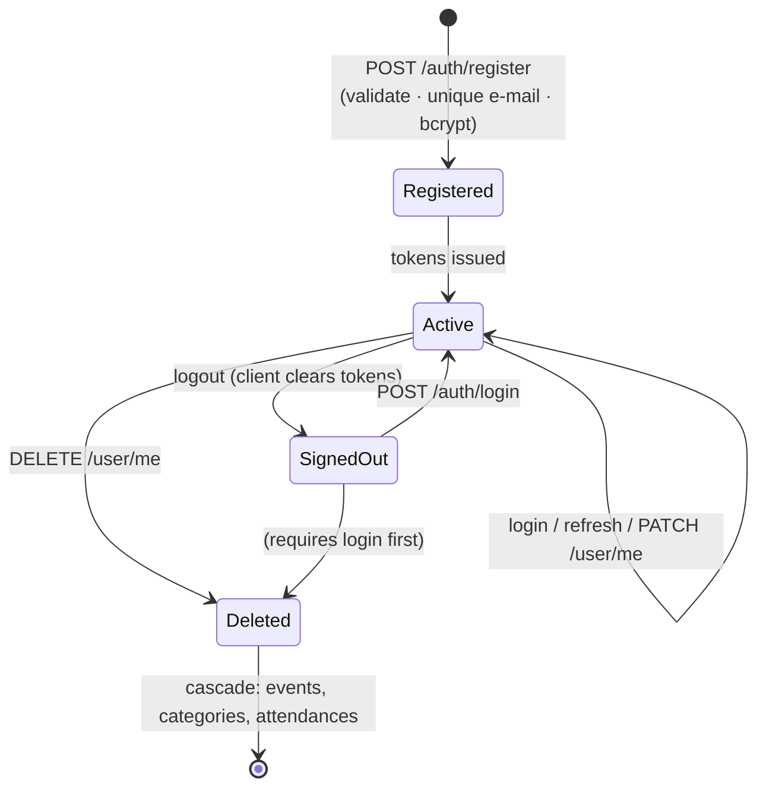
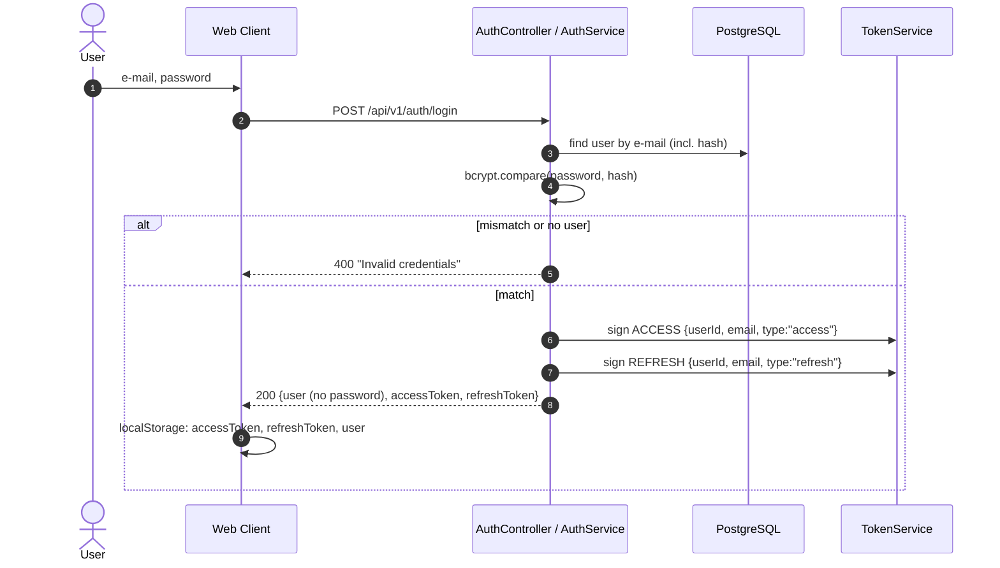
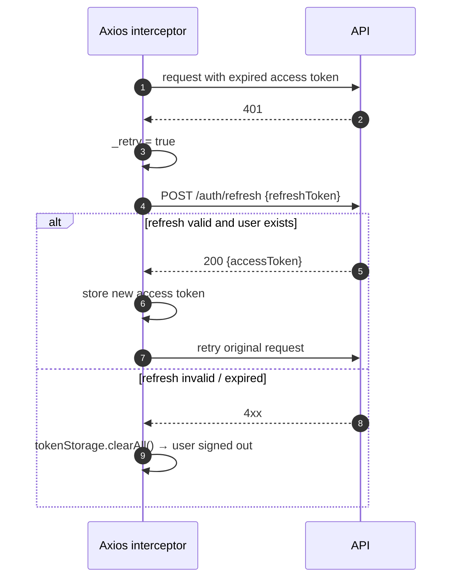

# Identity Management — Event Management System (EMS)

Companion to [SRS.md](SRS.md) and [UML.md](UML.md). This document describes how EMS identifies users, authenticates
them, decides what they may do, manages their sessions and protects their credentials. Section 8 compares the current
implementation with the target design.

1. [Scope and Principles](#1-scope-and-principles)
2. [Identities and Attributes](#2-identities-and-attributes)
3. [Identity Lifecycle](#3-identity-lifecycle)
4. [Authentication](#4-authentication)
5. [Tokens and Session Management](#5-tokens-and-session-management)
6. [Authorization](#6-authorization)
7. [Credential and Secret Protection](#7-credential-and-secret-protection)
8. [Gap Analysis and Roadmap](#8-gap-analysis-and-roadmap)
9. [IdM Requirements Summary](#9-idm-requirements-summary)

---

## 1. Scope and Principles

| In scope                                                | Out of scope (release 1.0)                                    |
|---------------------------------------------------------|---------------------------------------------------------------|
| End-user accounts (Attendee / Organizer)                | Single sign-on, social login, external IdP (OAuth 2.0 / OIDC) |
| Registration, login, token refresh, logout              | Multi-factor authentication                                   |
| Profile self-service and account deletion               | Administrator user management UI                              |
| Access control on API resources                         | Audit trail storage                                           |
| Technical identities: Swagger operator, CI/CD, services |                                                               |

Guiding principles:

- **Stateless authentication** — the API does not keep sessions; every request proves identity with a signed JWT.
- **Least exposure of credentials** — passwords exist only as bcrypt hashes; they are never returned or logged.
- **Identity from the token, not from the request** — server-side ownership fields (`createdById`) are taken from the
  authenticated user.
- **Defence in depth** — validation on the client (Zod) and on the server (Joi), integrity in the database (unique
  e-mail, foreign keys).

---

## 2. Identities and Attributes

### 2.1 Identity types

| Identity             | Kind                      | Store                                                | Authenticates with                      | Used for                               |
|----------------------|---------------------------|------------------------------------------------------|-----------------------------------------|----------------------------------------|
| **End user**         | Human                     | `users` table                                        | E-mail + password → JWT                 | All application features               |
| **Swagger operator** | Human (admin / developer) | Env vars `SWAGGER_USER`, `SWAGGER_PASSWORD`          | HTTP Basic auth                         | Reading `/api/docs`                    |
| **Backend service**  | Workload                  | Render env vars                                      | `DATABASE_URL` credentials, Redis host  | DB and cache access                    |
| **CI/CD pipeline**   | Workload                  | GitHub Secrets                                       | `RENDER_DATABASE_URL`, deploy hook URLs | Running migrations, triggering deploys |
| **Scraper bot**      | Automated end user        | Created at run time (`test_<timestamp>@example.com`) | Same as end user                        | UI smoke test                          |

### 2.2 End-user identity attributes

| Attribute                | Type             | Rules                                     | Notes                                                                |
|--------------------------|------------------|-------------------------------------------|----------------------------------------------------------------------|
| `id`                     | UUID v4          | Generated by the database, immutable      | **Primary identifier**; the only identifier placed in `userId` claim |
| `email`                  | string           | Valid e-mail, **unique**                  | Login name; can be changed by the user (uniqueness re-checked)       |
| `firstName`              | string           | 1–100 chars                               | Display name                                                         |
| `lastName`               | string           | 1–100 chars                               | Display name                                                         |
| `password`               | string, nullable | ≥ 6 chars on input, stored as bcrypt hash | Nullable to allow future passwordless / external-IdP accounts        |
| `createdAt`, `updatedAt` | timestamp        | Set by the database                       | Lifecycle metadata                                                   |

### 2.3 Roles (logical)

The data model has a single account type. Logical roles are derived from relationships:

| Role                           | Derived from                                                    | Capabilities                                                                |
|--------------------------------|-----------------------------------------------------------------|-----------------------------------------------------------------------------|
| **Guest**                      | No valid token                                                  | `POST /auth/register`, `POST /auth/login`, `POST /auth/refresh`             |
| **Registered user / Attendee** | Valid access token                                              | Read all events, categories, attendances; manage own profile; attend events |
| **Organizer / Owner**          | `Event.createdById = user.id`, `Category.createdById = user.id` | Intended: exclusive right to modify/delete own resources (see § 6, gap G-1) |
| **Administrator**              | Out-of-band (env vars, Render, GitHub)                          | Infrastructure, Swagger; no in-app role yet (gap G-2)                       |

---

## 3. Identity Lifecycle



| Stage               | Trigger           | System behaviour                                                                                                                                                                            | Requirement |
|---------------------|-------------------|---------------------------------------------------------------------------------------------------------------------------------------------------------------------------------------------|-------------|
| **Provisioning**    | Self-registration | Joi validation; `ConflictException` (409) if e-mail exists; password hashed with bcrypt (cost 10); user returned without password; access + refresh token issued                            | FR-AUTH-1   |
| **Authentication**  | Login             | Constant error message for unknown e-mail or wrong password                                                                                                                                 | FR-AUTH-2   |
| **Maintenance**     | `PATCH /user/me`  | Any of first/last name, e-mail, password; at least one field; new password re-hashed; e-mail uniqueness enforced                                                                            | FR-USER-1   |
| **Suspension**      | —                 | Not supported (gap G-6)                                                                                                                                                                     | —           |
| **De-provisioning** | `DELETE /user/me` | User row deleted; categories, events and attendances deleted by `ON DELETE CASCADE`. Tokens already issued stop working at the next request because `AuthGuard` loads the user and gets 404 | FR-USER-2   |

---

## 4. Authentication

### 4.1 Mechanisms

| Channel                          | Mechanism                                            | Where               |
|----------------------------------|------------------------------------------------------|---------------------|
| Web client → API (login)         | E-mail + password, verified with `bcrypt.compare`    | `AuthService.login` |
| Web client → API (every request) | `Authorization: Bearer <accessToken>` (RFC 6750)     | `AuthGuard`         |
| Operator → Swagger               | HTTP Basic (`express-basic-auth`, challenge enabled) | `swagger.config.ts` |

### 4.2 Login flow



### 4.3 Request authentication (`AuthGuard`)

1. Read the `Authorization` header; if missing → **401** "Missing or malformed token".
2. Take the last space-separated part as the token; if empty → **401**.
3. `TokenService.verifyTokenByType(token, ACCESS)`:
    - verify signature and expiry with `JWT_SECRET_KEY` → otherwise **400** "Invalid token";
    - check `type === "access"` → otherwise **400** "Invalid token" (a refresh token cannot be used as an access token).
4. Check that the payload has `userId` → otherwise **401** "Invalid payload".
5. Load the user from the database → **404** if it no longer exists (deleted account).
6. Attach the user to `req.user`; controllers read it with `@UserDetails()`.

### 4.4 Client-side route protection

- `AuthContext` restores the user and tokens from `localStorage` on load and exposes `isAuthenticated`.
- `ProtectedPage` wraps `/dashboard/*` and redirects to `/auth/login` when the user is not authenticated.
- `tokenStorage` accepts only strings with the JWT three-part structure and treats corrupted values as absent.

---

## 5. Tokens and Session Management

### 5.1 Token model

| Property       | Access token                                      | Refresh token                                      |
|----------------|---------------------------------------------------|----------------------------------------------------|
| Format         | JWT (HS256 via `@nestjs/jwt`)                     | JWT (HS256)                                        |
| Claims         | `userId`, `email`, `type: "access"`, `iat`, `exp` | `userId`, `email`, `type: "refresh"`, `iat`, `exp` |
| Lifetime       | `ACCESS_TOKEN_EXPIRE` (production: `1d`)          | `REFRESH_TOKEN_EXPIRE` (production: `7d`)          |
| Signing key    | `JWT_SECRET_KEY` (Render `generateValue`)         | same key                                           |
| Sent to        | Every protected endpoint (`Authorization` header) | Only `POST /auth/refresh` (JSON body)              |
| Client storage | `localStorage`                                    | `localStorage`                                     |
| Server storage | None (stateless)                                  | None (stateless)                                   |

### 5.2 Refresh flow



The refresh token itself is **not rotated**: the same refresh token is reused until it expires.

### 5.3 Logout

- The client calls `POST /auth/logout`, ignores any error, then clears tokens and the cached user from `localStorage`.
- The backend has **no** `/auth/logout` endpoint and keeps no token state, so logout is effective only on that device; a
  copied token stays valid until it expires (gap G-4).

---

## 6. Authorization

### 6.1 Current access-control matrix

`✓` = allowed, `—` = denied. "Any" means any authenticated user, regardless of ownership.

| Resource / operation                                | Guest           | Any authenticated user             | Owner only            |
|-----------------------------------------------------|-----------------|------------------------------------|-----------------------|
| Register / login / refresh                          | ✓               | ✓                                  |                       |
| Read / update / delete **own** profile (`/user/me`) | —               | ✓ (implicitly own — ID from token) | ✓                     |
| List / read events, categories, attendances         | —               | ✓                                  |                       |
| Create event / category                             | —               | ✓ (owner = token user)             |                       |
| Update / delete event                               | —               | **✓ (any)**                        | *intended*            |
| Update / delete category                            | —               | **✓ (any)**                        | *intended*            |
| Create attendance                                   | —               | **✓ for any `userId` in body**     | *intended: self only* |
| Update / delete attendance                          | —               | **✓ (any)**                        | *intended*            |
| Recommendations                                     | —               | ✓ (personalised by token user)     |                       |
| Swagger UI                                          | Basic auth only |                                    |                       |

Authorization is therefore **authentication-based (coarse-grained)**: being logged in is sufficient for every protected
operation. Ownership is recorded (`createdById`, `userId`) but not yet enforced for modifications.

### 6.2 Target model (next release)

```mermaid
flowchart LR
    R[Request] --> AG[AuthGuard<br/>who are you?]
    AG --> RG[RolesGuard<br/>@Roles USER / ADMIN]
    RG --> OG[OwnershipGuard / policy<br/>resource.createdById == user.id<br/>or user.role == ADMIN]
    OG -->|allowed| C[Controller]
    OG -->|denied| F[403 Forbidden]
```

| Rule | Policy                                                                                                |
|------|-------------------------------------------------------------------------------------------------------|
| AZ-1 | `PATCH/DELETE /event/:id` — only `event.createdById == user.id` or `ADMIN`                            |
| AZ-2 | `PATCH/DELETE /category/:id` — only `category.createdById == user.id` or `ADMIN`                      |
| AZ-3 | `POST /attendance` — `userId` taken from the token; body `userId` ignored                             |
| AZ-4 | `PATCH/DELETE /attendance/:id` — only `attendance.userId == user.id`, the event organizer, or `ADMIN` |
| AZ-5 | `GET /attendance/user/:userId` — only self or `ADMIN`                                                 |
| AZ-6 | Client hides edit/delete buttons for non-owners (UX only; server is authoritative)                    |

---

## 7. Credential and Secret Protection

| Asset                | Protection in release 1.0                                                                                                                                                        |
|----------------------|----------------------------------------------------------------------------------------------------------------------------------------------------------------------------------|
| User passwords       | bcrypt, cost 10 (`SALT_ROUND`); never selected except by `findUserByEmailWithPassword` during login; stripped from login response; redacted (`[REDACTED]`) in debug request logs |
| JWT signing key      | Env var `JWT_SECRET_KEY`, generated by Render; app fails fast at boot if missing (`envSchema`)                                                                                   |
| Database credentials | `DATABASE_URL` from Render database binding / `.env` (git-ignored); `.env.example` contains placeholders only                                                                    |
| Swagger credentials  | `SWAGGER_USER` / `SWAGGER_PASSWORD`, `sync: false` in `render.yaml` (set manually, not in git)                                                                                   |
| CI/CD secrets        | GitHub Secrets: `RENDER_BACKEND_DEPLOY_HOOK`, `RENDER_FRONTEND_DEPLOY_HOOK`, `RENDER_DATABASE_URL`                                                                               |
| Transport            | HTTPS in production (Render)                                                                                                                                                     |
| Tokens on the client | `localStorage` (readable by any script on the origin — see G-5)                                                                                                                  |

---

## 8. Gap Analysis and Roadmap

| ID       | Gap (current behaviour)                                                                                                                           | Risk                                           | Proposed solution                                                                                                                                                                                                      | Priority    |
|----------|---------------------------------------------------------------------------------------------------------------------------------------------------|------------------------------------------------|------------------------------------------------------------------------------------------------------------------------------------------------------------------------------------------------------------------------|-------------|
| **G-1**  | No ownership checks: any user can edit/delete any event, category or attendance                                                                   | High — data tampering                          | `OwnershipGuard` / service-level checks, 403 Forbidden (AZ-1..AZ-5)                                                                                                                                                    | Must        |
| **G-2**  | No roles; no in-app administrator                                                                                                                 | Medium                                         | `role` enum on `User` (`USER`, `ADMIN`), `@Roles()` + `RolesGuard`, role claim in access token                                                                                                                         | Should      |
| **G-3**  | Attendance can be created for another user and duplicated                                                                                         | Medium                                         | `userId` from token; `@@unique([userId, eventId])`                                                                                                                                                                     | Must        |
| **G-4**  | Logout is client-only; client calls a non-existent `/auth/logout`; refresh tokens cannot be revoked or rotated; one secret signs both token types | Medium — stolen refresh token valid for 7 days | Persist refresh tokens (hashed) with `jti`; rotate on every refresh with reuse detection; implement `POST /auth/logout` that revokes; separate `JWT_ACCESS_SECRET` / `JWT_REFRESH_SECRET`; shorter access TTL (15 min) | Should      |
| **G-5**  | Tokens in `localStorage`; CORS `origin: '*'`                                                                                                      | Medium — XSS can exfiltrate tokens             | Refresh token in `HttpOnly; Secure; SameSite=Strict` cookie, access token in memory; CORS allow-list of the frontend origin; Content-Security-Policy                                                                   | Should      |
| **G-6**  | No e-mail verification, password reset, account lock                                                                                              | Medium                                         | Verification link on sign-up; time-limited reset token; `status` (`ACTIVE`, `LOCKED`, `UNVERIFIED`)                                                                                                                    | Could       |
| **G-7**  | No rate limiting on `/auth/*`; weak password policy (≥ 6 chars)                                                                                   | Medium — brute force / credential stuffing     | `@nestjs/throttler` (e.g. 5 req/min/IP on login); minimum 8 chars with complexity or breached-password check                                                                                                           | Should      |
| **G-8**  | Invalid/expired token returns 400 instead of 401                                                                                                  | Low — client auto-refresh triggers only on 401 | Map JWT verification errors to `UnauthorizedException`                                                                                                                                                                 | Should      |
| **G-9**  | No audit log of security events                                                                                                                   | Low                                            | Log login success/failure, refresh, password change, account deletion with user ID and IP                                                                                                                              | Could       |
| **G-10** | No MFA / SSO                                                                                                                                      | Low for current audience                       | TOTP as optional second factor; OIDC login (Google) using nullable `password`                                                                                                                                          | Won't (1.0) |

### Roadmap

```mermaid
flowchart LR
    subgraph R11["Release 1.1 — Access control"]
        G1[G-1 Ownership checks]
        G3[G-3 Attendance from token + unique]
        G8[G-8 401 for bad tokens]
    end
    subgraph R12["Release 1.2 — Sessions & hardening"]
        G4[G-4 Refresh rotation, logout, split secrets]
        G5[G-5 HttpOnly cookie, CORS allow-list]
        G7[G-7 Rate limit, password policy]
        G2[G-2 Roles / Admin]
    end
    subgraph R2["Release 2.0 — Identity features"]
        G6[G-6 Verify e-mail, reset password]
        G9[G-9 Audit log]
        G10[G-10 MFA / SSO]
    end
    R11 --> R12 --> R2
```



---

## 9. IdM Requirements Summary

| ID     | Requirement                                                             | Status                    |
|--------|-------------------------------------------------------------------------|---------------------------|
| IDM-1  | Each user is identified by an immutable UUID; e-mail is unique          | Implemented               |
| IDM-2  | Self-service registration with server-side validation                   | Implemented (FR-AUTH-1)   |
| IDM-3  | Password-based login with non-enumerating error                         | Implemented (FR-AUTH-2)   |
| IDM-4  | Passwords stored only as bcrypt hashes, never returned or logged        | Implemented (NFR-1)       |
| IDM-5  | Typed, expiring access and refresh JWTs                                 | Implemented (NFR-2)       |
| IDM-6  | Transparent access-token refresh in the client                          | Implemented (FR-AUTH-3)   |
| IDM-7  | All non-auth endpoints require a valid access token of an existing user | Implemented (FR-AUTH-4)   |
| IDM-8  | Profile self-service and account deletion with cascade                  | Implemented (FR-USER-1/2) |
| IDM-9  | Swagger protected with basic auth                                       | Implemented (FR-OPS-1)    |
| IDM-10 | Ownership-based authorization for modifications                         | **Planned** (G-1, G-3)    |
| IDM-11 | Roles (USER / ADMIN)                                                    | **Planned** (G-2)         |
| IDM-12 | Server-side logout, refresh-token rotation and revocation               | **Planned** (G-4)         |
| IDM-13 | Brute-force protection on authentication endpoints                      | **Planned** (G-7)         |
| IDM-14 | E-mail verification and password reset                                  | **Planned** (G-6)         |
