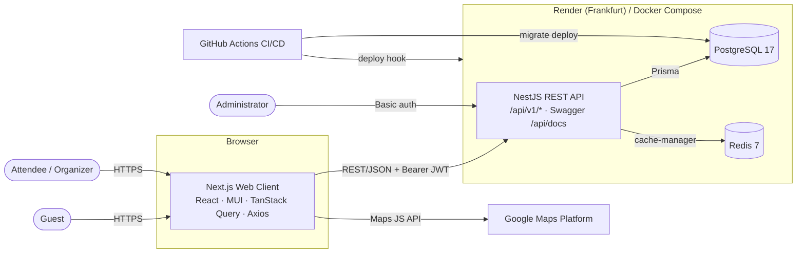
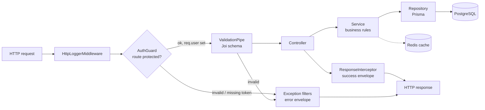

# Software Requirements Specification

## Event Management System (EMS)

|                 |                                                      |
|-----------------|------------------------------------------------------|
| **Version**     | 1.0                                                  |
| **Prepared by** | FourCast                                             |
| **Date**        | 2026-10-27                                           |
| **Status**      | Describes the system as implemented on branch `main` |

Related documents in this folder:

- [UML.md](UML.md) — UML models (use case, class, component, sequence, activity, state, deployment, ER)
- [IDENTITY_MANAGEMENT.md](IDENTITY_MANAGEMENT.md) — identity lifecycle, authentication, authorization and session
  management
- [ERROR_HANDLING.md](ERROR_HANDLING.md) — error response format, status codes and client handling

---

## Table of Contents

1. [Introduction](#1-introduction)
    1. [Purpose](#11-purpose)
    2. [Document Conventions](#12-document-conventions)
    3. [Intended Audience and Reading Suggestions](#13-intended-audience-and-reading-suggestions)
    4. [Product Scope](#14-product-scope)
    5. [Definitions, Acronyms and Abbreviations](#15-definitions-acronyms-and-abbreviations)
    6. [References](#16-references)
2. [Overall Description](#2-overall-description)
    1. [Product Perspective](#21-product-perspective)
    2. [Product Functions](#22-product-functions)
    3. [Actors / Personas](#23-actors--personas)
    4. [Operating Environment](#24-operating-environment)
    5. [Design and Implementation Constraints](#25-design-and-implementation-constraints)
    6. [User Documentation](#26-user-documentation)
    7. [Assumptions and Dependencies](#27-assumptions-and-dependencies)
3. [High-level Architecture](#3-high-level-architecture)
4. [External Interface Requirements](#4-external-interface-requirements)
5. [Functional Requirements](#5-functional-requirements)
6. [Non-functional Requirements](#6-non-functional-requirements)
7. [Data Requirements](#7-data-requirements)
8. [Known Limitations and Future Work](#8-known-limitations-and-future-work)
9. [Appendix A — Requirements Traceability](#appendix-a--requirements-traceability)

---

## 1. Introduction

### 1.1 Purpose

This document specifies the software requirements of the **Event Management System (EMS)**, release 1.0. It describes
what the system does, who uses it, how it is built and deployed, and the quality attributes it must meet. The
requirements are derived from the implemented code in this repository (`backend/`, `frontend/`) and are written so that
each one can be verified against the code, the Swagger documentation and the automated tests.

### 1.2 Document Conventions

- Requirement IDs: `FR-<area>-<n>` for functional, `NFR-<n>` for non-functional, `IR-<n>` for interface requirements.
- Priority uses MoSCoW: **Must**, **Should**, **Could**, **Won't (this release)**.
- "The system **shall**" denotes a mandatory requirement; "**should**" — a desirable one.
- All API paths are given relative to the backend base URL and already include the global prefix and version, e.g.
  `/api/v1/event`.
- Diagrams use [Mermaid](https://mermaid.js.org/) and render on GitHub.

### 1.3 Intended Audience and Reading Suggestions

| Reader                   | Recommended sections                                   |
|--------------------------|--------------------------------------------------------|
| Product owner / lecturer | 1, 2, 5                                                |
| Developers               | 3, 4, 5, 7, [UML.md](UML.md)                           |
| QA engineers             | 5, 6, Appendix A                                       |
| DevOps                   | 2.4, 3, 6                                              |
| Security reviewers       | 6, 8, [IDENTITY_MANAGEMENT.md](IDENTITY_MANAGEMENT.md) |

### 1.4 Product Scope

EMS is a web application in which registered users publish events (title, description, time range, address and map
coordinates, category), browse and filter events created by everyone, register their attendance and receive
recommendations of similar events.

Goals:

- give users a single place to publish and discover local events;
- let users find relevant events quickly through search, filters, a map and personalised recommendations;
- keep the system simple to deploy (Docker / Render free tier) and safe to evolve (typed code, automated tests,
  migrations checked in CI).

Out of scope for release 1.0: payments and ticketing, notifications (e-mail / push), social login, administrator
back-office, and moderation.

### 1.5 Definitions, Acronyms and Abbreviations

| Term               | Meaning                                                                                         |
|--------------------|-------------------------------------------------------------------------------------------------|
| **Event**          | A scheduled happening with a title, description, start/end date, location and optional category |
| **Category**       | A user-defined label used to group events (e.g. "Music", "IT Meetup")                           |
| **Attendance**     | A record that a user takes part in an event                                                     |
| **Recommendation** | A list of events similar to a given event, scored and sorted                                    |
| **Access token**   | Short-lived JWT sent in the `Authorization: Bearer` header                                      |
| **Refresh token**  | Longer-lived JWT used only to obtain a new access token                                         |
| API                | Application Programming Interface                                                               |
| CRUD               | Create, Read, Update, Delete                                                                    |
| DTO                | Data Transfer Object                                                                            |
| JWT                | JSON Web Token (RFC 7519)                                                                       |
| ORM                | Object-Relational Mapping (Prisma)                                                              |
| SPA / SSR          | Single-Page Application / Server-Side Rendering                                                 |
| IdM                | Identity Management                                                                             |

### 1.6 References

1. SRS template — <https://github.com/jam01/SRS-Template/blob/master/template.md>
2. Example SRS (USAID) — <https://pdf.usaid.gov/pdf_docs/Pnacu897.pdf>
3. IEEE 830-1998 / ISO/IEC/IEEE 29148:2018 — Requirements engineering
4. NestJS — <https://docs.nestjs.com>, Next.js — <https://nextjs.org/docs>, Prisma — <https://www.prisma.io/docs>
5. RFC 7519 (JWT), RFC 6750 (Bearer Token Usage)
6. Project README — [../README.md](../README.md)

---

## 2. Overall Description

### 2.1 Product Perspective

EMS is a new, self-contained product. It consists of three runtime parts and two managed data services:

- **Web client** — Next.js 16 application (React, MUI, Tailwind, TanStack Query) rendered in the user's browser;
- **REST API** — NestJS 11 application exposing `/api/v1/*` and Swagger UI at `/api/docs`;
- **PostgreSQL 17** — system of record, accessed through Prisma ORM;
- **Redis 7** — cache for computed recommendations;
- **Google Maps JavaScript API** — external service used by the client for map display, location picking and geocoding.

An additional **scraper** (Puppeteer, `backend/scraper/`) drives the web client end-to-end (register → login → scrape
events) and is used as a UI-level smoke test, not as a user-facing feature.

### 2.2 Product Functions

| Area               | Functions                                                                                                      |
|--------------------|----------------------------------------------------------------------------------------------------------------|
| Identity & account | Register, log in, refresh access token, view / edit / delete own profile, log out (client side)                |
| Events             | List with pagination, full-text search, category and date filters, sorting; view details; create; edit; delete |
| Location           | Pick location on a map, store coordinates, show events on a map, radius search for recommendations             |
| Categories         | List / search, create (inline from the event form), view, edit, delete when unused                             |
| Attendance         | Register attendance, list attendances (all / by event / by user), update, cancel                               |
| Recommendations    | "Similar events" for a selected event, personalised for the current user, cached                               |
| Operations         | Swagger docs behind basic auth, structured HTTP logging, health-checked containers, CI/CD to Render            |

### 2.3 Actors / Personas

The system has one authenticated role in the data model (`User`), but users act in distinct capacities. The following
actors are used throughout the requirements and the use case diagram in [UML.md](UML.md#1-use-case-diagram).

#### A1. Guest (unauthenticated visitor) — *primary, human*

> **Persona: "Iryna", 21, student.** Heard about EMS from a friend, opens the landing page on her phone and wants to see
> whether it is worth signing up.

- Can open the landing page, the registration page and the login page.
- Cannot access any event, category or attendance data — every API call except `/auth/*` requires a token.
- Goal: create an account or sign in quickly.

#### A2. Attendee (registered user) — *primary, human*

> **Persona: "Andrii", 27, backend developer in Lviv.** Looks for IT meetups and concerts on weekends, filters by
> category and dates, and wants suggestions of similar events near the ones he liked.

- Browses, searches and filters events; views event details and the map.
- Registers attendance and cancels it.
- Receives personalised recommendations of similar events.
- Manages own profile (name, e-mail, password) and can delete the account.

#### A3. Organizer (registered user who publishes events) — *primary, human*

> **Persona: "Olena", 34, community manager.** Runs a monthly design meetup and a few workshops; needs to publish events
> with an exact map location, group them by category and see who is coming.

- Everything an Attendee can do, plus:
- Creates, edits and deletes events; picks the location on the map.
- Creates and manages categories.
- Views the list of attendees of an event.

> Attendee and Organizer are the **same `User` entity**; "Organizer" is the user in the role of `Event.createdBy` /
`Category.createdBy`.

#### A4. System Administrator / DevOps — *secondary, human*

- Deploys the system (Docker Compose locally, Render in production), configures environment variables and secrets, runs
  migrations and seeds.
- Accesses Swagger UI protected with HTTP basic auth (`SWAGGER_USER` / `SWAGGER_PASSWORD`).
- Does not have a separate in-app role in release 1.0.

#### A5. External systems — *secondary, non-human*

| Actor                    | Interaction                                                                   |
|--------------------------|-------------------------------------------------------------------------------|
| **Google Maps Platform** | Renders maps, places markers, geocodes addresses in the browser               |
| **GitHub Actions**       | Runs lint, build, unit / e2e tests and the migrations check; triggers deploys |
| **Render**               | Hosts backend, frontend, PostgreSQL and Key-Value (Redis)                     |
| **Scraper bot**          | Automated client that drives the UI as a user (smoke test)                    |

### 2.4 Operating Environment

| Component          | Environment                                                                                        |
|--------------------|----------------------------------------------------------------------------------------------------|
| Client             | Any evergreen browser (Chrome, Firefox, Safari, Edge — last 2 versions), desktop and mobile widths |
| Backend            | Node.js ≥ 18 (Docker image), Linux container                                                       |
| Database           | PostgreSQL 17                                                                                      |
| Cache              | Redis 7 (Render Key-Value in production)                                                           |
| Production hosting | Render, region Frankfurt (`render.yaml`)                                                           |
| Local              | Docker Compose: `db`, `redis`, `migrator`, `backend` (port 4000), `frontend` (port 3000)           |

### 2.5 Design and Implementation Constraints

- **Languages / frameworks:** TypeScript end-to-end; NestJS on the server, Next.js (App Router) on the client.
- **Persistence:** Prisma ORM; every schema change must have a migration (enforced by the CI *Migrations Check* job).
- **Validation:** request bodies, params and queries validated with Joi schemas on the server and Zod schemas on the
  client.
- **API style:** REST over HTTPS, JSON, URI versioning (`/api/v1`), uniform response envelope.
- **Hosting:** Render free tier — services may sleep when idle, which affects cold-start latency.
- **Licensing:** only open-source dependencies; Google Maps requires an API key bound to the deployment domain.

### 2.6 User Documentation

- [README.md](../README.md) — installation, configuration, running, deployment.
- [Swagger UI](https://ems-backend-8b3e.onrender.com/api/docs#/) at `/api/docs` (JSON at `/api/docs/json`) — complete
  API reference with request/response schemas; the same document is generated into
  `backend/generated/openapi/swagger.json` by `npm run swagger:generate`.
- This SRS, [UML.md](UML.md), [IDENTITY_MANAGEMENT.md](IDENTITY_MANAGEMENT.md), [ERROR_HANDLING.md](ERROR_HANDLING.md).

### 2.7 Assumptions and Dependencies

- Users have a valid e-mail address (it is not verified in release 1.0).
- The Google Maps API key is configured; without it the map components degrade and location must be typed manually.
- Redis is reachable; recommendation caching depends on it.
- System clock of the backend is correct (JWT expiry relies on it).

---

## 3. High-level Architecture

### 3.1 Architectural Style

EMS follows a **three-tier client–server architecture**:

1. **Presentation tier** — Next.js web client. Pages under `src/app/` (`/`, `/auth/login`, `/auth/register`,
   `/dashboard`, `/dashboard/events/create`, `/dashboard/events/[id]`, `/dashboard/events/[id]/edit`), components
   grouped by feature, data access through TanStack Query hooks over an Axios client.
2. **Application tier** — NestJS REST API organised as **feature modules**, each with the layers *Controller → Service →
   Repository*:
    - `AuthModule`, `TokenModule`, `UserModule` — identity and access;
    - `EventModule`, `EventRecommendationModule` — events and recommendations (Strategy pattern for similarity);
    - `CategoryModule`, `AttendanceModule`;
    - `DatabaseModule` (Prisma client), `CacheModule` (Redis).
      Cross-cutting concerns are implemented once: `AuthGuard`, `ValidationPipe` (Joi), `ResponseInterceptor` (success
      envelope), exception filters (error envelope), `HttpLoggerMiddleware`.
3. **Data tier** — PostgreSQL (system of record) and Redis (cache).

### 3.2 Context / Container Diagram



### 3.3 Backend Request Pipeline



### 3.4 Key Design Decisions

| Decision                                                                                                                                                     | Rationale                                                                     |
|--------------------------------------------------------------------------------------------------------------------------------------------------------------|-------------------------------------------------------------------------------|
| Stateless JWT authentication (access + refresh)                                                                                                              | Horizontal scaling without a session store; simple SPA integration            |
| Layered modules with repositories                                                                                                                            | Business rules testable without the database (unit tests mock repositories)   |
| Strategy pattern for recommendation scoring (`CategorySimilarityStrategy`, `LocationSimilarityStrategy`, `TimeSimilarityStrategy`) + collaborative filtering | New similarity criteria can be added without changing the service             |
| Redis cache for recommendations (`similar_events:{eventId}:{userId}`)                                                                                        | Recommendation computation issues several queries; results are reused         |
| Uniform response envelope + exception filters                                                                                                                | Client handles all success/error responses the same way; no stack traces leak |
| Prisma migrations checked in CI                                                                                                                              | Prevents drift between `schema.prisma` and the production database            |

Detailed UML views are in [UML.md](UML.md).

---

## 4. External Interface Requirements

### 4.1 User Interfaces

| ID   | Requirement                                                                                                                                                           |
|------|-----------------------------------------------------------------------------------------------------------------------------------------------------------------------|
| IR-1 | The client shall provide pages: landing, login, register, dashboard (event list with filters and map), event details (with similar events), create event, edit event. |
| IR-2 | Forms shall validate input on the client before submission and show field-level error messages.                                                                       |
| IR-3 | Destructive actions (delete event, delete category) shall require confirmation in a dialog (`ConfirmationDialog`).                                                    |
| IR-4 | Loading and error states shall be shown for every asynchronous view (`Loading`, `ErrorMessage`, `ErrorBoundary`).                                                     |
| IR-5 | Pages under `/dashboard` shall be accessible only to authenticated users; otherwise the user is redirected to `/auth/login` (`ProtectedPage`).                        |

### 4.2 Software Interfaces

| ID   | Interface          | Description                                                                                        |
|------|--------------------|----------------------------------------------------------------------------------------------------|
| IR-6 | REST API           | JSON over HTTP(S), base path `/api/v1`, `Authorization: Bearer <accessToken>` for protected routes |
| IR-7 | PostgreSQL         | Through Prisma Client; connection string `DATABASE_URL`                                            |
| IR-8 | Redis              | Through `cache-manager-redis-store`; `REDIS_HOST`, `REDIS_PORT`, TTL `CACHE_TTL`                   |
| IR-9 | Google Maps JS API | Loaded in the browser with `NEXT_PUBLIC_GOOGLE_MAPS_API_KEY`                                       |

#### API endpoint summary

| Method               | Path                                    | Auth   | Purpose                                               |
|----------------------|-----------------------------------------|--------|-------------------------------------------------------|
| POST                 | `/api/v1/auth/register`                 | —      | Create account, return user + tokens                  |
| POST                 | `/api/v1/auth/login`                    | —      | Verify credentials, return user + tokens              |
| POST                 | `/api/v1/auth/refresh`                  | —      | Exchange refresh token for a new access token         |
| GET / PATCH / DELETE | `/api/v1/user/me`                       | Bearer | Read / update / delete current user                   |
| GET / POST           | `/api/v1/event`                         | Bearer | List (search, filter, sort, paginate) / create events |
| GET / PATCH / DELETE | `/api/v1/event/:id`                     | Bearer | Read / update / delete an event                       |
| GET                  | `/api/v1/event/recommendation?eventId=` | Bearer | Similar events for the current user                   |
| GET / POST           | `/api/v1/category`                      | Bearer | List / create categories                              |
| GET / PATCH / DELETE | `/api/v1/category/:id`                  | Bearer | Read / update / delete a category                     |
| GET / POST           | `/api/v1/attendance`                    | Bearer | List / create attendances                             |
| GET / PATCH / DELETE | `/api/v1/attendance/:id`                | Bearer | Read / update / delete an attendance                  |
| GET                  | `/api/v1/attendance/user/:userId`       | Bearer | Attendances of a user                                 |
| GET                  | `/api/v1/attendance/event/:eventId`     | Bearer | Attendances of an event                               |
| GET                  | `/api/docs`, `/api/docs/json`           | Basic  | Swagger UI / OpenAPI JSON                             |

#### Response envelope

Every response (success or error) uses the same `GlobalResponse` shape:

```json
{
  "statusCode": 201,
  "name": "CREATED",
  "message": "Event created successfully",
  "isError": false,
  "data": {}
}
```

For errors `isError` is `true`, `statusCode`/`name` carry the 4xx/5xx status and `data` holds error details (e.g.
validation messages) or `null`.

Paginated endpoints return in `data` a `PageResponse`:
`{ content: [...], pageNumber, pageSize, pageCount, totalCount }`.

### 4.3 Communications Interfaces

- HTTPS in production (TLS terminated by Render).
- CORS enabled for methods `GET, HEAD, PUT, PATCH, POST, DELETE` and headers `Content-Type, Accept, Authorization`.
- All payloads are UTF-8 JSON; dates are ISO 8601 strings.

---

## 5. Functional Requirements

Each requirement lists its priority, the actor(s), the realising code and the acceptance criteria.

### 5.1 Identity and Account Management

#### FR-AUTH-1 — User registration *(Must; Guest)*

The system shall let a guest create an account with first name, last name, e-mail and password.

- Validation: e-mail is a valid address; first and last name 1–100 characters; password ≥ 6 characters.
- The e-mail shall be unique; a duplicate returns **409 Conflict** ("User already exist").
- The password shall be stored only as a bcrypt hash.
- On success (**201**) the response contains the user (without password) and an access/refresh token pair; the client
  stores them and opens the dashboard.
- *Realised by:* `POST /auth/register`, `AuthService.register`, `RegisterForm`.

#### FR-AUTH-2 — User login *(Must; Guest)*

The system shall authenticate a user by e-mail and password.

- On success (**200**) it returns the user (without the password hash) and a new token pair.
- Unknown e-mail and wrong password produce the **same** error ("Invalid credentials", 400) so that registered e-mails
  cannot be enumerated.
- *Realised by:* `POST /auth/login`, `AuthService.login`, `LoginForm`.

#### FR-AUTH-3 — Access token refresh *(Must; Attendee, Organizer)*

The system shall issue a new access token for a valid, unexpired refresh token whose user still exists.

- A token of the wrong type (an access token sent as refresh) is rejected.
- The client shall refresh transparently on a 401 response and retry the original request once; if refresh fails it
  clears stored tokens.
- *Realised by:* `POST /auth/refresh`, Axios response interceptor in `frontend/src/lib/api/client.ts`.

#### FR-AUTH-4 — Protected resources *(Must; all)*

All endpoints other than `/auth/*` shall require a valid access token in the `Authorization: Bearer` header; the
authenticated user is attached to the request.

- Missing/malformed header → **401**; invalid or expired token → **400** "Invalid token"; token whose user was deleted →
  **404**.
- *Realised by:* `AuthGuard`, `@UserDetails()` decorator.

#### FR-USER-1 — View and update own profile *(Must; Attendee, Organizer)*

The system shall let an authenticated user read their profile and update any of first name, last name, e-mail and
password.

- At least one field is required; the same validation as registration applies; a new password is re-hashed; changing to
  an e-mail that is taken returns **409**.
- *Realised by:* `GET/PATCH /user/me`.

#### FR-USER-2 — Delete own account *(Should; Attendee, Organizer)*

The system shall let a user delete their account; the user's events, categories and attendances shall be deleted with
it (cascade).

- *Realised by:* `DELETE /user/me`, `onDelete: Cascade` relations.

#### FR-USER-3 — Log out *(Must; Attendee, Organizer)*

The client shall provide a log-out action that removes the stored tokens and user data and redirects to the login page.

- *Realised by:* `AuthContext.logout`, `tokenStorage.clearAll`.

### 5.2 Event Management

#### FR-EVT-1 — Create event *(Must; Organizer)*

The system shall let a user create an event with: title (1–200), description (1–1000), start date, end date (≥ start
date), location text (1–500), optional latitude (−90…90) and longitude (−180…180), optional category.

- The creator is taken from the access token, not from the request body.
- A non-existent `categoryId` returns **404** "Category not found".
- *Realised by:* `POST /event`, `EventService.createEvent`, `CreateEventPage`, `EventForm`, `LocationPicker`.

#### FR-EVT-2 — Browse events *(Must; Attendee, Organizer)*

The system shall return a paginated list of events (page number ≥ 1, page size 1–500) including category and creator
summary.

- *Realised by:* `GET /event`, `EventList`, `EventCard`, `EventsPageContainer`.

#### FR-EVT-3 — Search, filter and sort events *(Must; Attendee, Organizer)*

The event list shall support:

- text `search` (1–255 characters), case-insensitive, over event title and description;
- `categoryId` filter;
- `startDate` / `endDate` range (ISO 8601, end ≥ start);
- `sortBy` ∈ {`date`, `title`, `createdAt`} and `sortOrder` ∈ {`asc`, `desc`}.

Invalid query parameters return **400** with a description of each error. Filters are reflected in the URL so that a
filtered view can be shared or reloaded.

- *Realised by:* `eventQuerySchema`, `EventFilterBuilder`, `EventFilters`, `queryParams` util.

#### FR-EVT-4 — View event details *(Must; Attendee, Organizer)*

The system shall show an event's full details, its category, its creator, its location on a map and the list of similar
events. A non-existent ID returns **404**; a malformed ID returns **400**.

- *Realised by:* `GET /event/:id`, `EventDetailPage`, `EventMap`, `SimilarEvents`.

#### FR-EVT-5 — Edit event *(Must; Organizer)*

The system shall let a user change any subset of an event's fields with the same validation rules as creation.

- *Realised by:* `PATCH /event/:id`, `EditEventPage`.

#### FR-EVT-6 — Delete event *(Must; Organizer)*

The system shall let a user delete an event after confirmation; its attendances are deleted with it.

- *Realised by:* `DELETE /event/:id`, `ConfirmationDialog`.

#### FR-EVT-7 — Map-based location *(Should; Organizer, Attendee)*

The client shall let the organizer choose the event location by clicking on / searching a Google Map, filling both the
address text and coordinates, and shall show events with coordinates as markers on a map.

- *Realised by:* `LocationPicker`, `EventMap`, `MapWrapper`, `geocoding` util.

### 5.3 Category Management

#### FR-CAT-1 — Create category *(Must; Organizer)*

The system shall let a user create a category with a name and optional description, owned by that user. The client shall
allow creating a category inline from the event form.

- *Realised by:* `POST /category`, `CreateCategoryDialog`, `CategorySelector`.

#### FR-CAT-2 — List, view and edit categories *(Must; Attendee, Organizer)*

The system shall return a paginated, searchable-by-name list of categories, a single category by ID and allow partial
updates.

- *Realised by:* `GET /category`, `GET/PATCH /category/:id`.

#### FR-CAT-3 — Delete unused category *(Must; Organizer)*

The system shall delete a category only if no event references it; otherwise it returns **409 Conflict** "Category is
used by events".

- *Realised by:* `CategoryService.deleteCategory`, `onDelete: Restrict` on `Event.category`.

### 5.4 Attendance

#### FR-ATT-1 — Register attendance *(Must; Attendee)*

The system shall record that a user attends an event. Both the user and the event must exist (**404** otherwise).

- *Realised by:* `POST /attendance`, `useAttendance` hook.

#### FR-ATT-2 — View attendances *(Must; Attendee, Organizer)*

The system shall return attendances paginated (optionally filtered by event), by event ID (participants list) and by
user ID (user's history).

- *Realised by:* `GET /attendance`, `/attendance/event/:eventId`, `/attendance/user/:userId`.

#### FR-ATT-3 — Update / cancel attendance *(Must; Attendee)*

The system shall allow changing an attendance's user/event and deleting (cancelling) an attendance.

- *Realised by:* `PATCH/DELETE /attendance/:id`.

### 5.5 Recommendations

#### FR-REC-1 — Similar events *(Should; Attendee)*

For a given event, the system shall return up to **10** other events sorted by a similarity score in [0, 1].

1. **Candidate generation** (max 100, deduplicated): events of the same category (≤ 50), events starting within 90 days
   after the given event (≤ 30), events within **50 km** of its coordinates (≤ 30), and collaborative candidates.
2. **Scoring** — weighted sum: category **0.4**, location **0.3**, time **0.2**, collaborative **0.1**.
3. **Collaborative filtering** — users who attended the same events as the current user are "similar"; if there are at
   least **3** of them, events they attended (and the current user did not) get the collaborative component.
4. The given event and events the user already attends are excluded.

- *Realised by:* `GET /event/recommendation?eventId=`, `EventRecommendationService`, similarity strategies,
  `SimilarEvents`.

#### FR-REC-2 — Recommendation caching *(Should; System)*

The system shall cache recommendation results per (event, user) in Redis under the key
`similar_events:{eventId}:{userId}` with a configurable TTL, and serve repeated requests from the cache.

- *Realised by:* `CacheService.getOrSet`, `CacheModule`.

### 5.6 Platform and Operations

#### FR-OPS-1 — API documentation *(Must; Administrator, developers)*

The system shall publish an OpenAPI 3 description of every endpoint (Swagger UI at `/api/docs`, JSON at
`/api/docs/json`) protected by HTTP basic authentication.

#### FR-OPS-2 — Uniform error handling *(Must; System)*

All errors shall be returned as the error envelope with the correct 4xx status for client errors (validation, not found,
conflict, unauthorized) and 500 only for unexpected server errors; internal details shall not be leaked.

#### FR-OPS-3 — Request logging *(Should; Administrator)*

The system shall log every request (method, URL, IP, user agent) and response (status, duration). In `debug` mode it
shall additionally log headers and bodies with passwords redacted.

#### FR-OPS-4 — Database migrations and seed *(Must; Administrator)*

Schema changes shall be applied with Prisma migrations; a seeder shall populate realistic demo users, categories, events
and attendances for development.

### 5.7 Functional Requirements Summary

| ID        | Title                         | Priority | Actor               |
|-----------|-------------------------------|----------|---------------------|
| FR-AUTH-1 | User registration             | Must     | Guest               |
| FR-AUTH-2 | User login                    | Must     | Guest               |
| FR-AUTH-3 | Access token refresh          | Must     | Attendee, Organizer |
| FR-AUTH-4 | Protected resources           | Must     | All                 |
| FR-USER-1 | View / update profile         | Must     | Attendee, Organizer |
| FR-USER-2 | Delete account                | Should   | Attendee, Organizer |
| FR-USER-3 | Log out                       | Must     | Attendee, Organizer |
| FR-EVT-1  | Create event                  | Must     | Organizer           |
| FR-EVT-2  | Browse events                 | Must     | Attendee, Organizer |
| FR-EVT-3  | Search, filter, sort          | Must     | Attendee, Organizer |
| FR-EVT-4  | View event details            | Must     | Attendee, Organizer |
| FR-EVT-5  | Edit event                    | Must     | Organizer           |
| FR-EVT-6  | Delete event                  | Must     | Organizer           |
| FR-EVT-7  | Map-based location            | Should   | Organizer, Attendee |
| FR-CAT-1  | Create category               | Must     | Organizer           |
| FR-CAT-2  | List / view / edit categories | Must     | Attendee, Organizer |
| FR-CAT-3  | Delete unused category        | Must     | Organizer           |
| FR-ATT-1  | Register attendance           | Must     | Attendee            |
| FR-ATT-2  | View attendances              | Must     | Attendee, Organizer |
| FR-ATT-3  | Update / cancel attendance    | Must     | Attendee            |
| FR-REC-1  | Similar events                | Should   | Attendee            |
| FR-REC-2  | Recommendation caching        | Should   | System              |
| FR-OPS-1  | API documentation             | Must     | Administrator       |
| FR-OPS-2  | Uniform error handling        | Must     | System              |
| FR-OPS-3  | Request logging               | Should   | Administrator       |
| FR-OPS-4  | Migrations and seed           | Must     | Administrator       |

---

## 6. Non-functional Requirements

### 6.1 Security

| ID        | Requirement                                                                                                                                                                                                                                                                      | Verification                                                                                   |
|-----------|----------------------------------------------------------------------------------------------------------------------------------------------------------------------------------------------------------------------------------------------------------------------------------|------------------------------------------------------------------------------------------------|
| **NFR-1** | Passwords shall be hashed with bcrypt (cost factor 10) and never returned by any endpoint or written to logs.                                                                                                                                                                    | Unit tests of `AuthService`/`UserService`; e2e auth tests; `HttpLoggerMiddleware.sanitizeBody` |
| **NFR-2** | Access and refresh tokens shall be signed JWTs with a secret of ≥ 32 random bytes (generated by Render) and limited lifetimes (`ACCESS_TOKEN_EXPIRE`, production 1 day; `REFRESH_TOKEN_EXPIRE`, 7 days); each token carries a `type` claim and is accepted only for its purpose. | `TokenService` unit tests; `render.yaml`                                                       |
| **NFR-3** | Every input (body, params, query) shall be validated against a schema before reaching business logic; IDs must be UUIDs.                                                                                                                                                         | `ValidationPipe` + Joi schemas; e2e tests send invalid payloads                                |
| **NFR-4** | Secrets (DB URL, JWT secret, Swagger credentials, deploy hooks) shall be provided via environment variables / GitHub Secrets and never committed; the app shall refuse to start if a required variable is missing.                                                               | `envSchema` (Joi) validation at boot; `.env.example` contains no real secrets                  |
| **NFR-5** | Production traffic shall be served over HTTPS only.                                                                                                                                                                                                                              | Render TLS termination                                                                         |

### 6.2 Performance

| ID        | Requirement                                                                                                                                                                                             |
|-----------|---------------------------------------------------------------------------------------------------------------------------------------------------------------------------------------------------------|
| **NFR-6** | With a warm instance and ≤ 10 000 events, 95 % of list/detail API requests shall complete in **< 500 ms** server time (logged by `HttpLoggerMiddleware`).                                               |
| **NFR-7** | A repeated recommendation request for the same (event, user) within the cache TTL shall be served from Redis in **< 100 ms** server time.                                                               |
| **NFR-8** | Lists shall always be paginated (max page size 500) and filtered/sorted in the database using indexes on `events.created_by_id`, `events.category_id`, `events.start_date`, `categories.created_by_id`. |

### 6.3 Reliability and Availability

| ID         | Requirement                                                                                                                                                                              |
|------------|------------------------------------------------------------------------------------------------------------------------------------------------------------------------------------------|
| **NFR-9**  | Containers shall start only after their dependencies are healthy (`pg_isready`, `redis-cli ping` health checks); backend and frontend restart automatically (`restart: unless-stopped`). |
| **NFR-10** | Referential integrity shall be enforced in the database (foreign keys, `Cascade` / `Restrict` rules), not only in code.                                                                  |
| **NFR-11** | Production database migrations shall be applied by CI **before** the new backend version is deployed.                                                                                    |

### 6.4 Maintainability and Testability

| ID         | Requirement                                                                                                                                                                                                                 |
|------------|-----------------------------------------------------------------------------------------------------------------------------------------------------------------------------------------------------------------------------|
| **NFR-12** | Code shall be written in strict TypeScript and pass ESLint and Prettier; CI fails on lint errors.                                                                                                                           |
| **NFR-13** | Every backend service, repository, controller, guard, filter and interceptor shall have unit tests (`*.spec.ts`), and every module shall have e2e tests against a real PostgreSQL (`test/e2e`). CI runs both on every push. |
| **NFR-14** | The *Migrations Check* job shall fail if `schema.prisma` differs from the result of applying all migrations to an empty database.                                                                                           |
| **NFR-15** | New recommendation criteria shall be addable by implementing `SimilarityStrategy` without modifying existing strategies (Open/Closed principle).                                                                            |

### 6.5 Usability

| ID         | Requirement                                                                                                                                |
|------------|--------------------------------------------------------------------------------------------------------------------------------------------|
| **NFR-16** | The client shall be responsive from 360 px to desktop widths.                                                                              |
| **NFR-17** | Every validation error shall be shown next to the corresponding field with a human-readable message (messages defined in Joi/Zod schemas). |
| **NFR-18** | A new user shall be able to register and create their first event in **under 3 minutes** without documentation.                            |

### 6.6 Portability and Deployability

| ID         | Requirement                                                                                                                    |
|------------|--------------------------------------------------------------------------------------------------------------------------------|
| **NFR-19** | The whole stack shall start locally with one command: `docker-compose up --build`.                                             |
| **NFR-20** | Production infrastructure shall be described as code (`render.yaml`) and deployed automatically from `main` by GitHub Actions. |

### 6.7 Scalability

| ID         | Requirement                                                                                                                                |
|------------|--------------------------------------------------------------------------------------------------------------------------------------------|
| **NFR-21** | The backend shall be stateless (JWT, no server sessions, shared Redis cache) so that it can be scaled horizontally behind a load balancer. |

---

## 7. Data Requirements

### 7.1 Logical Data Model

| Entity         | Attributes                                                                                                                            | Relations                                                            |
|----------------|---------------------------------------------------------------------------------------------------------------------------------------|----------------------------------------------------------------------|
| **User**       | `id` (UUID), `firstName`, `lastName`, `email` (unique), `password` (bcrypt hash, nullable), `createdAt`, `updatedAt`                  | 1 — * Category (created), 1 — * Event (created), 1 — * Attendance    |
| **Category**   | `id`, `name`, `description?`, `createdById`, timestamps                                                                               | * — 1 User (Cascade), 1 — * Event                                    |
| **Event**      | `id`, `title`, `description`, `startDate`, `endDate`, `location`, `latitude?`, `longitude?`, `createdById`, `categoryId?`, timestamps | * — 1 User (Cascade), * — 0..1 Category (Restrict), 1 — * Attendance |
| **Attendance** | `id`, `userId`, `eventId`, timestamps                                                                                                 | * — 1 User (Cascade), * — 1 Event (Cascade)                          |

The ER diagram is in [UML.md § 8](UML.md#8-entity-relationship-diagram).

### 7.2 Data Retention and Integrity

- Deleting a user deletes their categories, events and attendances.
- Deleting an event deletes its attendances.
- A category in use by an event cannot be deleted.
- All timestamps are stored in UTC.

---

## 8. Known Limitations and Future Work

These items were identified while writing this specification. They are **not** satisfied by release 1.0 and are
candidates for the next release. Details and proposed designs are
in [IDENTITY_MANAGEMENT.md § 8](IDENTITY_MANAGEMENT.md#8-gap-analysis-and-roadmap).

| #   | Limitation                                                                                               | Proposed requirement                                                                                     |
|-----|----------------------------------------------------------------------------------------------------------|----------------------------------------------------------------------------------------------------------|
| L-1 | Any authenticated user can edit or delete any event, category or attendance (no ownership check).        | Only the owner (`createdById` / `userId`) may modify or delete a resource → **403 Forbidden** otherwise. |
| L-2 | No roles; administrator has no in-app capabilities.                                                      | Introduce `role` (`USER`, `ADMIN`) and role-based guard.                                                 |
| L-3 | Attendance can be created for another user (`userId` taken from body) and duplicates are allowed.        | Take `userId` from the token; unique constraint on (`userId`, `eventId`).                                |
| L-4 | Logout is client-side only; refresh tokens cannot be revoked; the same secret signs both token types.    | Server-side refresh-token rotation and revocation list; separate secrets.                                |
| L-5 | Tokens are stored in `localStorage` (XSS exposure); CORS allows any origin.                              | HttpOnly Secure cookies for the refresh token; CORS allow-list.                                          |
| L-6 | No e-mail verification, password reset or rate limiting on `/auth/*`.                                    | Verification and reset flows via e-mail; throttling (e.g. 5 login attempts / min / IP).                  |
| L-7 | Attendance has no indexes and the `Attendance` table name is not mapped to snake_case like other tables. | Add indexes on `userId`, `eventId` and `@@map("attendances")`.                                           |

---

## Appendix A — Requirements Traceability

| Requirement  | Backend                                                               | Frontend                                                        | Tests                                                                       |
|--------------|-----------------------------------------------------------------------|-----------------------------------------------------------------|-----------------------------------------------------------------------------|
| FR-AUTH-1..3 | `modules/auth/*`, `modules/token/*`                                   | `LoginForm`, `RegisterForm`, `AuthContext`, `lib/api/client.ts` | `auth.service.spec.ts`, `token.service.spec.ts`, `test/e2e/modules/auth`    |
| FR-AUTH-4    | `guards/user.guard.ts`                                                | `ProtectedPage`                                                 | `user.guard.spec.ts`, all e2e suites                                        |
| FR-USER-1..3 | `modules/user/*`                                                      | `AuthContext`, `userService`                                    | `me.controller.spec.ts`, `user.service.spec.ts`, `test/e2e/modules/user`    |
| FR-EVT-1..7  | `modules/event/*`                                                     | `components/events/*`, `components/maps/*`                      | `event.*.spec.ts`, `event-filter.builder.spec.ts`, `test/e2e/modules/event` |
| FR-CAT-1..3  | `modules/category/*`                                                  | `components/category/*`                                         | `category.*.spec.ts`, `test/e2e/modules/category`                           |
| FR-ATT-1..3  | `modules/attendance/*`                                                | `useAttendance`                                                 | `attendance.*.spec.ts`, `test/e2e/modules/attendance`                       |
| FR-REC-1..2  | `modules/event/recommendation/*`, `modules/cache/*`                   | `SimilarEvents`                                                 | `event-recommendation.*.spec.ts`, `cache.service.spec.ts`                   |
| FR-OPS-1..4  | `configs/swagger.config.ts`, `filters/*`, `middlewares/*`, `prisma/*` | —                                                               | `*.filter.spec.ts`, `response.interceptor.spec.ts`, CI `migrations-check`   |
| NFR-12..14   | ESLint/Prettier, Jest                                                 | ESLint                                                          | `.github/workflows/backend.yml`, `frontend.yml`                             |
