# UML Models — Event Management System (EMS)

Companion to [SRS.md](SRS.md). All diagrams are written in [Mermaid](https://mermaid.js.org/) and render directly on
GitHub. Requirement IDs (`FR-…`) refer to [SRS § 5](SRS.md#5-functional-requirements).

1. [Use Case Diagram](#1-use-case-diagram)
2. [Component Diagram](#2-component-diagram)
3. [Class Diagram — Domain Model](#3-class-diagram--domain-model)
4. [Class Diagram — Backend Services](#4-class-diagram--backend-services)
5. [Sequence Diagrams](#5-sequence-diagrams)
6. [Activity Diagram — Create Event](#6-activity-diagram--create-event)
7. [State Diagram — Client Session](#7-state-diagram--client-session)
8. [Entity-Relationship Diagram](#8-entity-relationship-diagram)
9. [Deployment Diagram](#9-deployment-diagram)

---

## 1. Use Case Diagram

Mermaid has no native use case notation, so actors are drawn as rounded nodes and use cases as ellipse-like stadium
nodes inside the system boundary. `Organizer` **generalises** `Attendee` (inherits all its use cases); both specialise
`Registered User`.

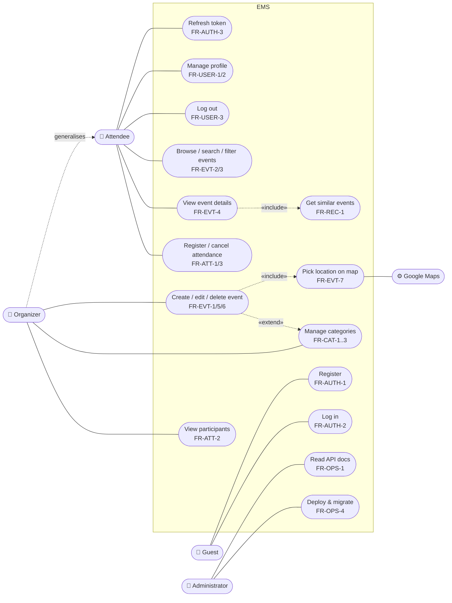

### Use case descriptions (main ones)

| UC   | Name                | Primary actor | Preconditions    | Main success scenario                                                                                                                                                                                    | Alternative flows                                                |
|------|---------------------|---------------|------------------|----------------------------------------------------------------------------------------------------------------------------------------------------------------------------------------------------------|------------------------------------------------------------------|
| UC1  | Register            | Guest         | Not logged in    | 1. Opens `/auth/register`. 2. Enters name, e-mail, password. 3. System validates, hashes password, creates user, issues tokens. 4. Client stores tokens, opens dashboard.                                | 3a. Invalid data → field errors. 3b. E-mail taken → 409 message. |
| UC2  | Log in              | Guest         | Account exists   | 1. Opens `/auth/login`. 2. Enters credentials. 3. System verifies bcrypt hash, issues tokens. 4. Dashboard opens.                                                                                        | 3a. Wrong e-mail or password → "Invalid credentials".            |
| UC6  | Browse events       | Attendee      | Logged in        | 1. Opens dashboard. 2. Sets search / category / dates / sort. 3. System returns a page of events. 4. Client renders cards and map markers.                                                               | 2a. Invalid filter → 400 with messages.                          |
| UC9  | Register attendance | Attendee      | Event exists     | 1. Opens event. 2. Clicks "Attend". 3. System creates Attendance. 4. Participant list refreshes.                                                                                                         | 3a. Event deleted meanwhile → 404.                               |
| UC10 | Create event        | Organizer     | Logged in        | 1. Opens create page. 2. Fills form, picks location on map (UC11), optionally creates category (UC12). 3. System validates and stores event with `createdById` from token. 4. Redirect to event details. | 3a. End before start → 400. 3b. Unknown category → 404.          |
| UC8  | Get similar events  | Attendee      | Viewing an event | 1. Client requests recommendations. 2. System returns cached result or computes candidates, scores and caches them. 3. Up to 10 events shown.                                                            | 2a. No candidates → empty list.                                  |

---

## 2. Component Diagram

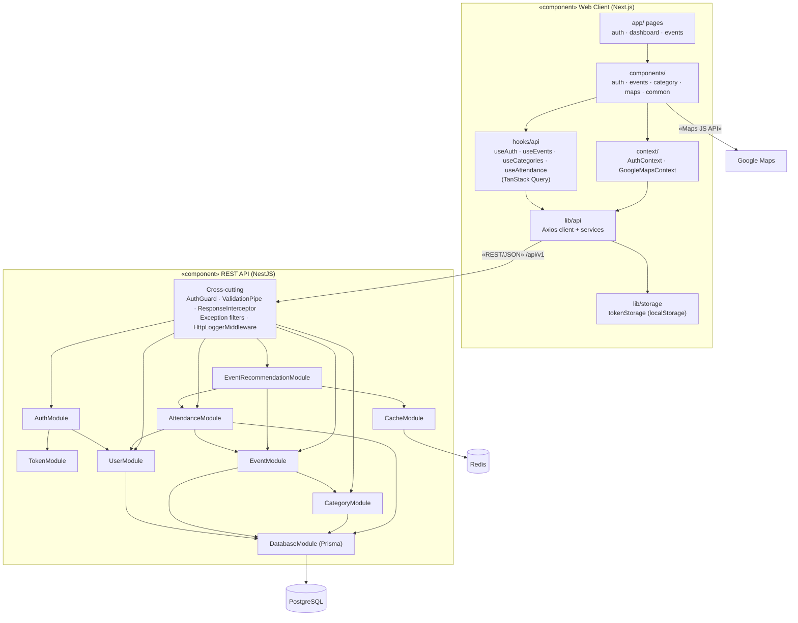

---

## 3. Class Diagram — Domain Model

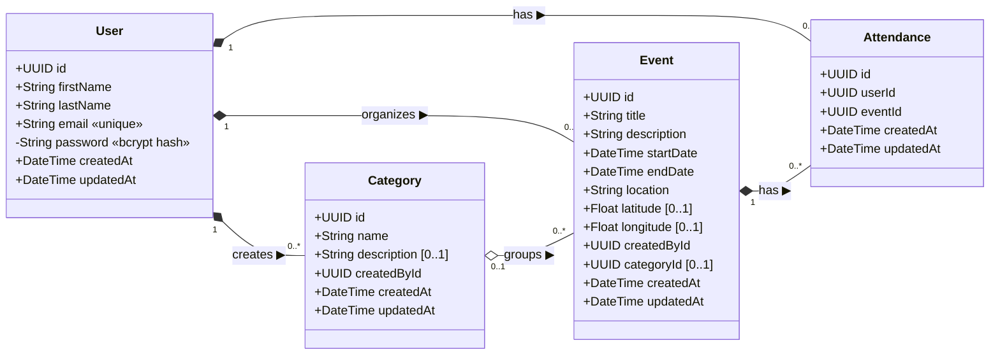

Composition (`*--`) marks cascade delete; aggregation (`o--`) marks `onDelete: Restrict` (a category cannot be removed
while events reference it).

---

## 4. Class Diagram — Backend Services

Shows the layered design (Controller → Service → Repository) and the Strategy pattern used for recommendations.

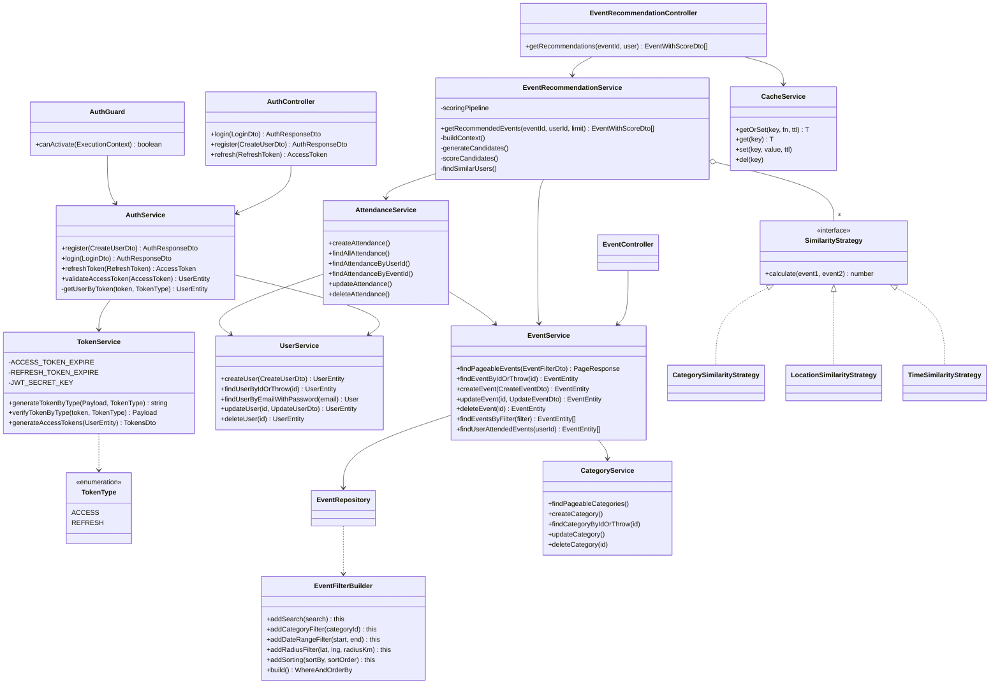

---

## 5. Sequence Diagrams

### 5.1 Login (FR-AUTH-2)

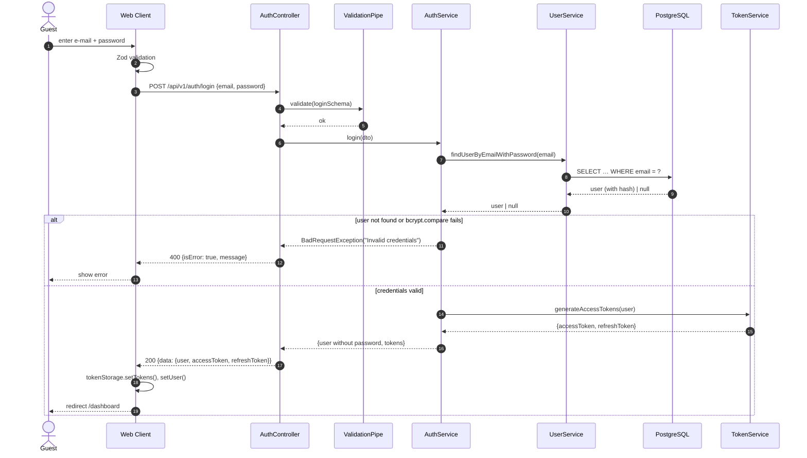

### 5.2 Authenticated request with transparent token refresh (FR-AUTH-3, FR-AUTH-4)

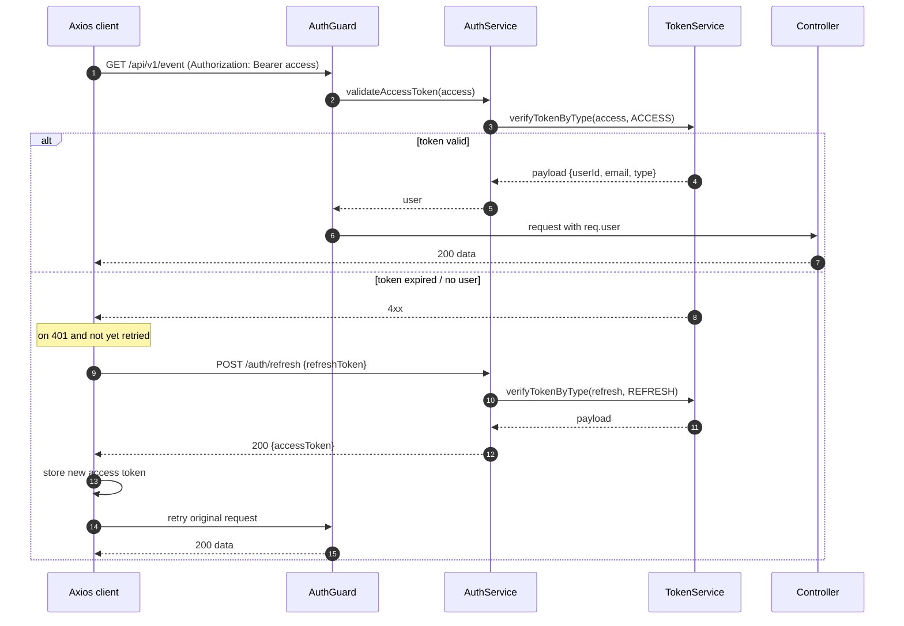

### 5.3 Create event (FR-EVT-1)

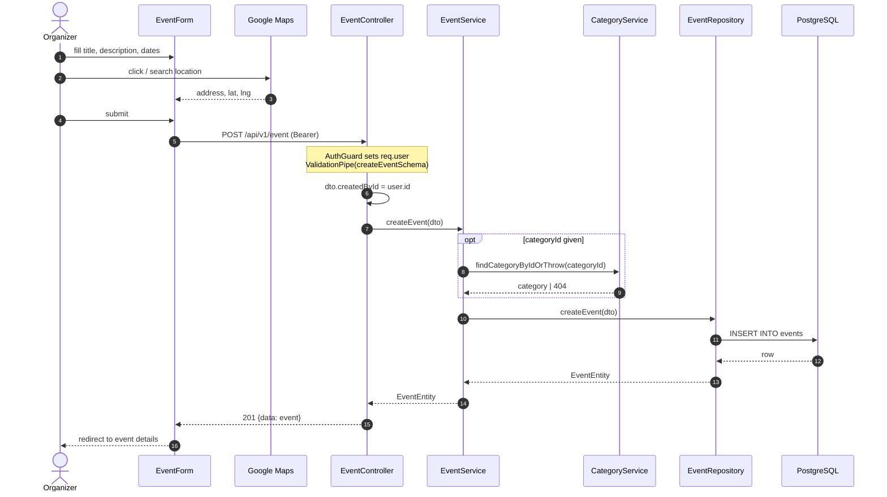

### 5.4 Similar events with cache (FR-REC-1, FR-REC-2)

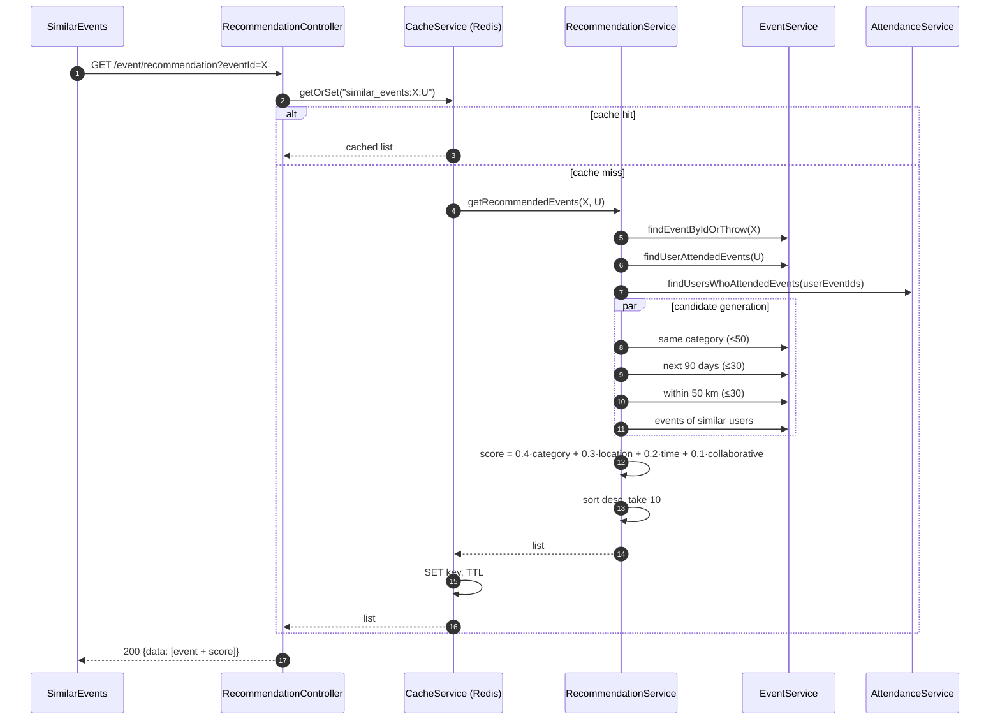

---

## 6. Activity Diagram — Create Event

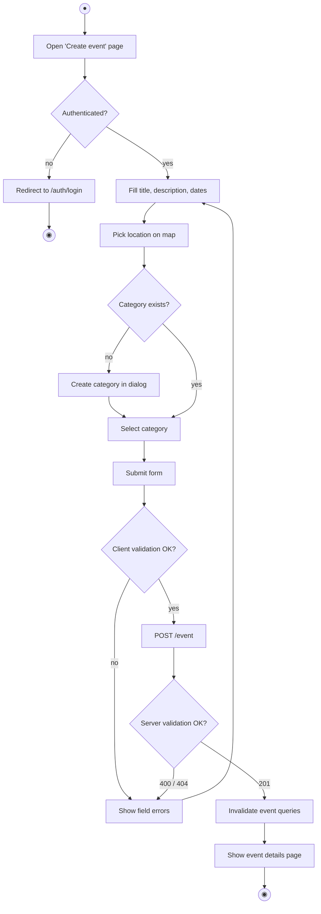

---

## 7. State Diagram — Client Session

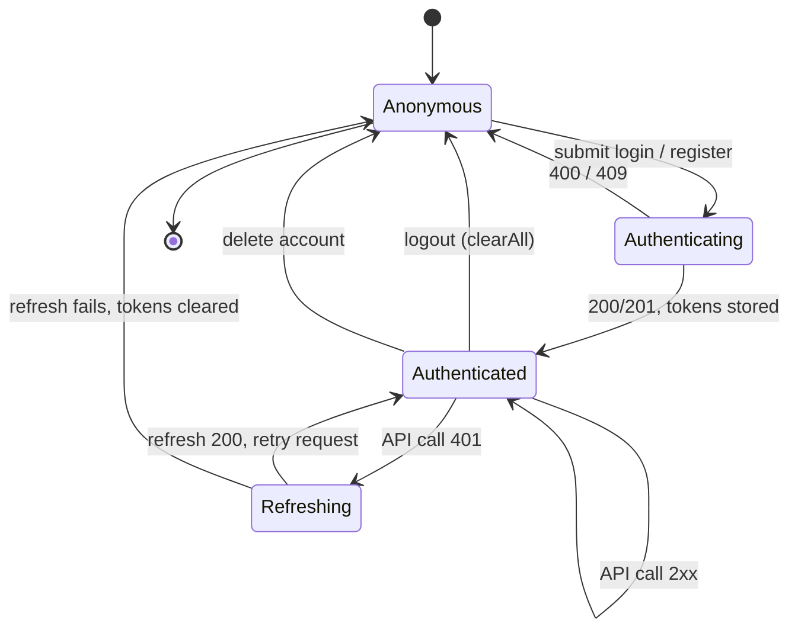

---

## 8. Entity-Relationship Diagram

Physical schema as defined in `backend/prisma/schema.prisma`.

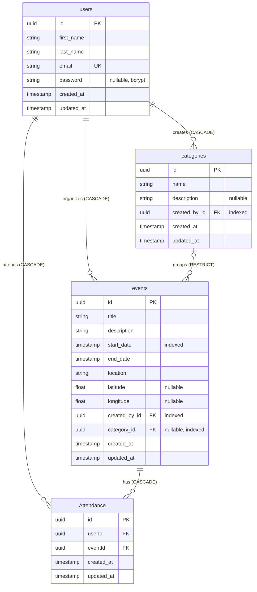

---

## 9. Deployment Diagram

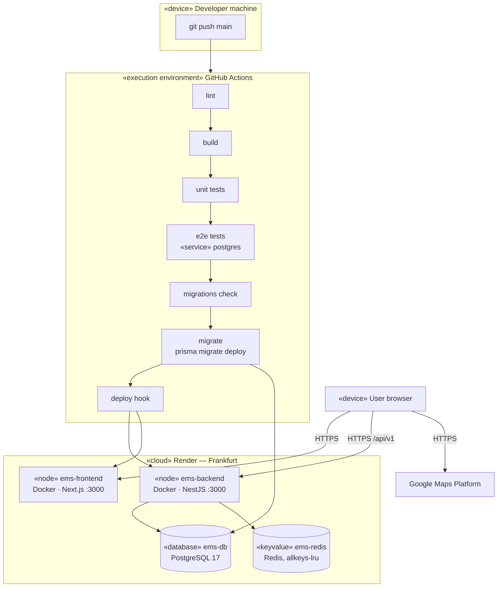

Local equivalent (`docker-compose.yaml`): `db` (postgres:17) and `redis` (redis:7-alpine) with health checks →
`migrator` (one-shot `prisma migrate deploy`) → `backend` (host port 4000) → `frontend` (host port 3000), all on the
`app-network` bridge.
